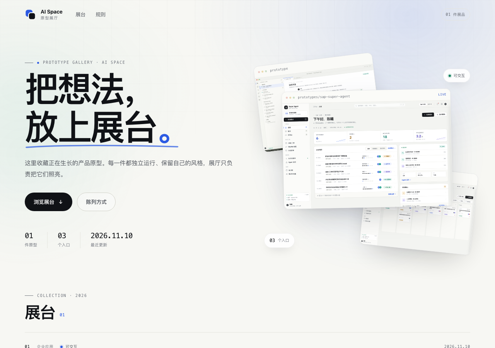
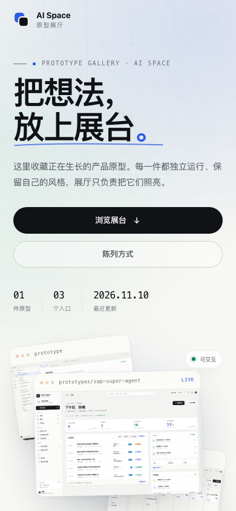

# AI Space · 原型展厅

一个跑在**项目级 GitHub Pages** 上的可交互原型展厅。每个原型独立存在、独立运行；展厅只做索引、筛选和陈列。

- 明亮、安静的外壳，轻量动画：首屏拼贴、标题描线、滚动 reveal、卡片悬浮、展台转场
- 原型通过 `<iframe>` 隔离，任何技术栈、任何视觉风格都能原样陈列
- 纯静态、零构建、零运行时依赖；展厅本身可离线打开
- 数据驱动：新增一件只动一个目录 + 一处 registry
- 为 Agent 准备：`AGENTS.md` + 三个 `skills/` 操作手册 + 校验 / 脚手架脚本

当前展品：**SAP Super Agent**（设计总览 / Web 工作台 / VSCode 插件）。

## 预览

<p>
  
  
</p>

## 本地预览

```bash
npm run dev
# http://localhost:4173/
```

需要 Node ≥ 18，但**不需要 `npm install`**（脚本只用 Node 内置模块）。

也可以使用任意静态服务器：

```bash
python3 -m http.server 4173
```

> 建议用本地服务器预览。直接双击 `index.html` 也能看到展厅，但个别浏览器会对 `file://` 下的 iframe / 剪贴板做限制。

## 目录结构

```text
.
├── index.html                  # 展厅入口
├── assets/
│   ├── site.css                # 展厅设计系统与布局
│   ├── site.js                 # 数据渲染、筛选、舞台、深链接
│   └── favicon.svg
├── data/
│   └── prototypes.js           # 原型登记表（唯一数据源）
├── prototypes/
│   ├── _template/              # 新原型脚手架
│   └── sap-super-agent/        # 展品 01，自包含静态站点
│       ├── index.html          # 设计总览
│       ├── app.html            # Web 工作台
│       ├── vscode.html         # VSCode 插件
│       ├── assets/  screens/  docs/  screenshots/
│       └── ...
├── skills/
│   ├── add-prototype/SKILL.md
│   ├── update-prototype/SKILL.md
│   └── publish-gallery/SKILL.md
├── scripts/
│   ├── serve.mjs               # 本地服务器
│   ├── validate.mjs            # 发布前校验
│   └── new-prototype.mjs       # 复制模板 + 自动登记
├── docs/                       # README 预览图
├── .github/workflows/deploy.yml
├── .nojekyll
├── AGENTS.md
└── README.md
```

## 新增一个原型

```bash
npm run new -- my-prototype "我的原型"
```

脚本会：

1. 复制 `prototypes/_template/` 到 `prototypes/my-prototype/`
2. 替换标题、slug、日期占位符
3. 在 `data/prototypes.js` 的 `@registry:end` 标记前插入一条记录
4. 自动跑一次校验

接下来：

1. 用你的原型文件替换 `prototypes/my-prototype/index.html`；需要构建的框架先构建，再把产物放进来。
2. 用真实截图替换 `cover.svg`（推荐 1440×900，16:10，文件名 `cover.png`）。
3. 补全 registry 的 `summary`、`category`、`status`、`tags`、`entries` 等字段。
4. `npm run validate`，然后 `npm run dev` 打开展厅和 `/prototypes/my-prototype/` 各检查一遍。

更完整的步骤见 [`skills/add-prototype/SKILL.md`](skills/add-prototype/SKILL.md)。

### registry 字段

| 字段 | 必填 | 说明 |
| --- | --- | --- |
| `slug` | ✓ | 目录名，小写字母 / 数字 / 连字符，对应 `prototypes/<slug>/` |
| `title` | ✓ | 展台标题 |
| `summary` | ✓ | 一句话介绍，不要营销话术 |
| `category` | | 用于筛选，例如 `企业应用` |
| `status` | | `可交互` / `设计稿` / `进行中` |
| `accent` | | 16 进制强调色，只影响卡片细节；不填用展厅默认蓝 |
| `cover` | | 封面图，相对原型目录；推荐 1440×900 |
| `screens` | | 首屏拼贴截图，最多 3 张，相对原型目录；不填用 `cover` |
| `updated` | | `YYYY-MM-DD` |
| `tags` | | 卡片小标签数组 |
| `entries` | ✓ | 原型入口数组：`{ label, path }`，`path` 相对原型目录，可带 `#hash` |
| `featured` | | 最多一个；会成为首屏精选拼贴 |

示例：

```js
{
  slug: "my-prototype",
  title: "我的原型",
  summary: "一句话说明它解决什么问题。",
  category: "企业应用",
  status: "可交互",
  accent: "#0b8f7c",
  cover: "cover.png",
  screens: ["screenshots/home.png", "screenshots/detail.png"],
  updated: "2026-11-10",
  tags: ["AI", "工作台"],
  entries: [
    { label: "原型", path: "index.html" },
    { label: "详情", path: "index.html#/detail" }
  ]
}
```

## 更新已有原型

1. 替换 `prototypes/<slug>/` 内的文件；入口路径变了就同步改 `registry.entries`。
2. 把 `updated` 改成今天；状态、摘要、标签有变化一并更新。
3. 视觉变化明显时，重截 `cover` 和 `screens`。
4. `npm run validate` → `npm run dev` 预览 → 提交。

Agent 可以按 [`skills/update-prototype/SKILL.md`](skills/update-prototype/SKILL.md) 执行。

## 部署到项目级 GitHub Pages

前置：有一个 GitHub 仓库；公开仓库最省事。发布会通过仓库自带的 Actions 工作流完成。

```bash
git init -b main            # 如果还没初始化
git add -A
git commit -m "feat: prototype gallery"
git remote add origin https://github.com/<owner>/<repo>.git
git push -u origin main
```

然后在 GitHub 上：

1. 打开仓库 **Settings → Pages**
2. **Build and deployment → Source** 选 **GitHub Actions**
3. 推送到 `main` 会触发 `.github/workflows/deploy.yml`；也可以手动 **Run workflow**
4. 发布地址：`https://<owner>.github.io/<repo>/`

例如仓库叫 `pages`，地址就是 `https://<owner>.github.io/pages/`。

要点：

- 所有链接都是相对路径，`/<repo>/` 子路径下可直接工作；改仓库名不用改代码。
- 工作流会先跑 `node scripts/validate.mjs`，registry 有问题就不会发布。
- 如果更想用「Deploy from a branch」：Settings → Pages → Source 选 **Deploy from a branch** → `main` / `/(root)`。根目录已有 `.nojekyll`；但这种方式没有发布前校验，不推荐。
- 自定义域名：在根目录放 `CNAME` 文件，或在 Pages 设置里填写域名。
- GitHub Pages 有软限制：仓库/站点建议 < 1 GB，单文件 < 100 MB；不要把视频原片和设计源文件放进来。

## 展厅如何工作

- **数据驱动**：`index.html` 只有展厅骨架；`assets/site.js` 从 `data/prototypes.js` 渲染首屏、卡片、筛选和舞台。
- **舞台**：点击卡片或「打开原型」打开 `iframe`，可在设计总览 / 各入口之间切换，支持桌面 / 平板 / 手机三种预览宽度。
- **深链接**：`#p=sap-super-agent&e=1&v=mobile` 可以复现同一件展品、同一个入口和预览宽度，适合贴到需求或 PR 里。
- **隔离**：展厅不向 iframe 注入样式，也不改写原型 DOM；原型自己的字体、颜色、布局完全保留。
- **可访问性**：舞台打开后背景 `inert`、焦点移入面板、Esc 关闭、关闭后焦点归还；同时尊重 `prefers-reduced-motion`。
- **性能**：无第三方依赖；封面图懒加载；iframe 只在打开舞台时创建/装载。

## 校验

```bash
npm run validate
```

会检查：

- registry 能否解析、字段是否合法、slug 是否重复、`featured` 是否超过一个
- 每个原型目录是否存在、入口 / 封面 / 拼贴图是否真实存在
- 封面是否为合理比例（PNG 会检查 16:10 和最小宽度）
- `prototypes/` 下是否有目录漏登记
- 是否出现 `/assets/...` 这类在项目级 Pages 下会失效的根路径引用
- `.nojekyll` 和部署工作流是否存在

## 给 Agent 的入口

- [`AGENTS.md`](AGENTS.md)：仓库规则、目录地图、硬约束、完成标准
- [`skills/add-prototype/SKILL.md`](skills/add-prototype/SKILL.md)：新增原型
- [`skills/update-prototype/SKILL.md`](skills/update-prototype/SKILL.md)：更新原型
- [`skills/publish-gallery/SKILL.md`](skills/publish-gallery/SKILL.md)：校验、提交、发布

## 当前边界

- 只陈列仓库内的静态原型；需要后端或登录的交互请先做静态演示版，或把完整服务单独部署。
- 原型自己的响应式、路由、字体问题由原型负责；展厅不会替它修补。
- GitHub Pages 不支持服务端逻辑；私有仓库使用 Pages 需要对应 GitHub 计划。
