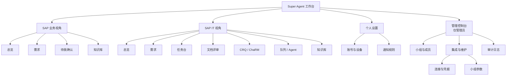
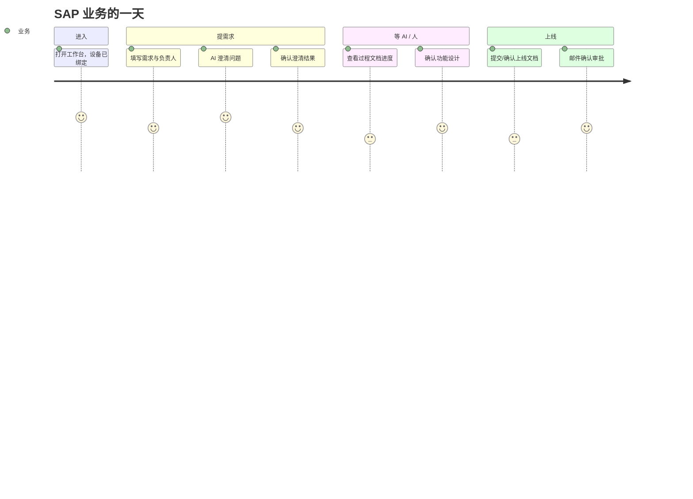

# 00 · 重构方案与信息架构

> 本文回答三个问题：现有产品为什么需要重构、新界面长什么样、从哪里开始落地。  
> 原型入口：[`index.html`](../index.html) · Web：[`app.html`](../app.html) · VSCode：[`vscode.html`](../vscode.html)

## 1. 背景

现有 SAP Super Agent 已经具备一套可运行的领域能力：需求（Demand）、阶段运行（StageRun）、任务与租约（Task / Assignment）、工件与版本（Artifact）、门禁（Approval）、Hook 与事件。但界面能力集中在三个狭窄入口：

- SAP ICF 页面：需求列表、创建、审批——信息密度低，无法承载过程文档、CRQ / ChaRM、队列与 Agent。
- VSCode 任务箱：开发者能看到任务，但看不到完整的需求上下文与过程文档，文档同步依赖手工操作。
- 外部系统（邮件、Teams、SolMan）：关键动作跨系统发生，状态与投递结果不可见。

从本次重构的诉求看，产品的真实形态不是「一个审批页」，而是 **面向 SAP 交付的智能体工作台**：业务、IT、AI 与外部系统在一条可追溯的链路上协作。

## 2. 现状问题

| # | 问题 | 影响 |
| --- | --- | --- |
| 1 | 账号只有登录，没有设备绑定 | 每次访问依赖 SSO；邮件邀请 / 一次性链接 / 指纹绑定流程缺失 |
| 2 | 需求只存在于 SAP 页面，过程文档无处评审 | AI 产出无法被业务确认；文档版本、批注、门禁割裂 |
| 3 | CRQ / ChaRM 是多步外部接口，操作不进产品 | 定制字段靠人记；失败与中间状态不可见；无法重试 |
| 4 | 队列、Webhook、API 调用是黑盒 | 失败只能翻日志；通知是否送达无从确认 |
| 5 | VSCode 是孤立客户端 | 开发者需要在浏览器与编辑器之间复制上下文 |
| 6 | 角色视角混杂 | 业务方与 IT 看到同一套信息，术语与动作不匹配 |
| 7 | 角色与权限不可见 | 设置页对所有账号展示管理员徽标与集成凭据；管理入口没有成员边界；「能管什么」由文案而不是权限决定 |
| 8 | 视觉无系统 | 表格、按钮、状态色不统一；信息层级靠加粗和颜色硬撑 |

## 3. 重构目标

一句话：**让每一次交付动作都能在界面里被看见、被确认、被追溯。**

成功标准（可验证）：

1. 业务方能在 3 分钟内完成：提需求 → 看 AI 澄清 → 确认文档 → 提交上线审批。
2. 开发者能在不离开 VSCode 的情况下完成：领任务 → 看上下文 → 开发 → 提交工件。
3. 任何一个失败（CRQ、ChaRM、Webhook、AI 运行、集成）都能在 2 次点击内定位到：哪一步、什么请求、什么响应、如何重试。
4. 所有关键状态变化都能回到需求时间线；所有文档修改都产生新版本，不覆盖历史。
5. 视觉上只有一套系统：同一状态在任何页面都是同一种颜色与组件。
6. 业务与 IT 看到不同的导航、默认落地与动作；每个管理动作都能追溯到操作人、目标与结果。

## 4. 产品定位与三个平面

与现有架构保持一致，界面按三个平面组织：

| 平面 | 记录什么 | 界面落点 |
| --- | --- | --- |
| **需求平面（SAP）** | 需求、审批、业务事实、账号与小组 | 需求列表 / 详情、上线审批、CRQ、ChaRM |
| **控制平面（Super Agent）** | 阶段、任务、工件、门禁、事件、队列 | 工作台、过程文档、队列与事件、Agent 运行 |
| **执行平面（VSCode / 服务端 AI）** | 代码、上下文包、本地 SSO、Agent / Skill | VSCode 插件、Copilot 协作、同步与冲突 |

> 真相归属不变：SAP 存业务，控制平面存执行态，VSCode 存代码工作区。界面只做投影与操作，不互写真相。

## 5. 角色、视角与权限

一个人如何被识别，拆成三个正交的层：

| 层 | 取值 | 谁决定 | 影响 |
| --- | --- | --- | --- |
| **工作视角** `view` | SAP 业务 / SAP IT | 双视角账号自助切换；单视角账号不显示切换器 | 导航、默认落地、首页信息、页面可操作项 |
| **业务角色** `role` | 业务 / 需求顾问 / 开发 / 测试 / Basis | 小组管理员调整 | 任务类型、门禁职责、文档评审身份 |
| **管理权限** `admin` | 平台管理员 / 小组管理员 / 无 | 平台管理员授予；小组管理员可任命本组管理员 | 是否出现「管理」入口，以及管理范围 |

- 视角是**视图**，不改变权限：切到 SAP IT 视角不会获得 IT 的写权限；权限不足时页面显示只读与原因。
- 业务角色与小组绑定：一人一组，角色由小组关系决定；管理权限单独授予，可以既是 SAP 业务，又是本组管理员。
- 管理权限只有两级（平台级 / 小组级），不设第三级自定义角色。

**小组模型**：每个账号只属于一个小组，角色由小组关系决定。小组决定需求默认可见范围、默认阶段模板、CRQ 模板、通知频道、集成默认参数与数据默认归属。成员与小组规则的维护在管理控制台 `#/admin?tab=groups`，权限边界见 [06-角色权限与管理.md](06-角色权限与管理.md)。

**权限矩阵（摘要）**

`●` 可操作 · `○` 只读 · `—` 不可见

| 能力 | 平台管理员 | 小组管理员 | 成员 |
| --- | --- | --- | --- |
| 管理控制台入口 | ● | ● | — |
| 创建 / 归档小组、管理全部小组 | ● | — | — |
| 邀请 / 移除本组成员、调整业务角色 | ● | ● | — |
| 任命 / 取消小组管理员 | ● | ● | — |
| 成员跨组转移 | ● | — | — |
| 本组默认模板 / 审批人 | ● | ● | — |
| 集成连接与凭据 / Webhook / 服务账号 | ● | ○ | — |
| 本组集成参数（默认值） | ●（代为） | ●（主责） | — |
| 审计日志 | ● | ○（本组） | — |
| CRQ / ChaRM、队列 / Agent 操作 | 随视角 | 随视角 | — |
| 个人设备重绑 / 通知规则 | ● | ● | ● |

完整 16 项矩阵、行操作边界与实现约定见 [06-角色权限与管理.md §2.3](06-角色权限与管理.md#23-权限矩阵)。

**业务角色的流程职责**（导航由视角决定，不由业务角色决定）：

| 业务角色 | 职责 | 典型落点 |
| --- | --- | --- |
| SAP 业务 | 提需求、确认文档、上线审批 | 总览 / 待我确认 |
| 需求顾问 | 受理、补充负责人、文档门禁、协调 CRQ / ChaRM | 需求详情 / 文档评审 |
| 开发 | 领取任务、VSCode 开发、提交工件、文档同步 | 任务台 / VSCode |
| 测试 | 测试用例与证据、业务验收 | 任务台 / 需求详情 |
| Basis | ChaRM 审批、上线执行、集成排障 | ChaRM / 队列与 Agent |

演示账号：陈曦 / 财务共享组 · FIN-SH / 业务角色 SAP 业务 / 双视角 / 平台管理员。成员表另有小组管理员样例（林桦），用来展示两级权限差别，见 [06 §2.2](06-角色权限与管理.md#22-演示账号原型)。

## 6. 信息架构

### 全局壳

- **左侧栏**：品牌、我的小组（管理员直达管理控制台，成员进个人设置看只读信息）、新建需求、按当前视角分组的导航（工作台 / 交付工具 / 自动化 / 空间；管理员多一个「管理」组）、执行器状态（仅 IT 视角）、用户卡；可收起为 72px 图标轨（右侧 tooltip、计数圆点、顶栏展开按钮）。
- **顶栏**：面包屑、全局搜索（`⌘K` 命令面板）、工作视角切换（双视角账号才显示）、通知、帮助、头像。
- **视角切换**：导航、默认落地、首页信息与页面动作一起变；当前路由不属于新视角时落到该视角默认页（业务 → 总览，IT → 任务台）。
- **个人设置与管理控制台是两个路由**：`#/settings` 只放账号、设备与通知；`#/admin` 只放小组与成员、集成与维护、审计，仅管理员可见，普通成员直接访问显示无权限页。
- **主区域**：`max-width 1320px` 的内容区；详情页采用「主内容 + 右侧上下文栏」。
- **浮层**：通知抽屉、详情抽屉、命令面板、确认弹窗、Toast。

## 7. 页面清单

| # | 路由 | 名称 | 角色 | 目标 |
| --- | --- | --- | --- | --- |
| 01 | `#/welcome` | 注册 / 账号绑定 | 新用户 | 邮箱邀请、小组关联、发送一次性链接 |
| 02 | `#/verify` | 邮件已发送 | 新用户 | 邮件预览、有效期倒计时 |
| 03 | `#/bind` | 设备绑定 | 新用户 | 链接 / 指纹 / IP / 用户名校验与结果 |
| 04 | `#/rebind` | 重新注册设备 | 已绑定用户 | 换设备、解除旧设备 |
| 05 | `#/home` | 工作台总览 | 业务 / IT（双视角） | 按视角呈现需求进度或任务健康；`?view=it` 为 IT 视角 |
| 06 | `#/demands` | 需求 | 业务 / IT | 列表 / 看板 / JIRA Backlog 三种视图 |
| 07 | `#/demands/new` | 新建需求 | 业务 | 三步向导：信息 → AI 澄清 → 确认提交 |
| 08 | `#/demands/:id` | 需求详情 | 全角色 | 六阶段、过程文档、门禁、关联工单、活动 |
| 09 | `#/demands/:id/doc/:doc` | 文档评审 | 业务 / 顾问 / 开发 | 批注、版本对比、检查清单、门禁决策 |
| 10 | `#/demands/:id/release` | 上线与审批 | 业务 / IT | 上线文档、邮件审批、CRQ 提交 |
| 11 | `#/tasks` | 待我确认 / 任务台 | 业务 / IT | 业务视角为待我确认（门禁、上线审批、澄清）；IT 视角为任务台 |
| 12 | `#/tools/crq` | CRQ 工单 | IT / 顾问（业务只读） | 工单列表、状态与多步编排详情 |
| 13 | `#/tools/crq/new` | 新建 CRQ | IT | 模板表单 + 实时编排与接口日志 |
| 14 | `#/tools/crq/templates` | CRQ 模板 | 管理员 / IT | 本组模板 × 版本；字段来源、下拉选项与默认值（ChaRM 拉取） |
| 15 | `#/tools/charm` | ChaRM 变更 | IT / Basis（业务只读） | CR / CD、Basis 审批、轮询与字段 |
| 16 | `#/ops/queue` | 队列与事件 | IT / 运维 | 队列、事件流、Webhook、外部 API |
| 17 | `#/ops/agents` | Agent 运行 | IT / 顾问 | 运行列表、计划、工具调用、成本与输出 |
| 18 | `#/knowledge` | 知识库 | 全角色 | 来源、索引、引用热度、检索测试；业务只读 |
| 19 | `#/settings` | 个人设置 | 全角色 | 账号与设备、通知规则（`?tab=account/notify`） |
| 20 | `#/admin` | 管理控制台 | 平台管理员 / 小组管理员 | 小组与成员（`?tab=groups`）、集成与维护（`?tab=integrations&sub=connection\|params`）、审计日志（`?tab=audit`）；无权限显示无权限页 |
| — | 全局 | 通知抽屉 | 全角色 | 待处理 / 全部通知 |
| — | 全局 | 命令面板 | 全角色 | 跳转、命令、需求搜索 |

管理控制台子视图：`#/admin?tab=groups`（默认）/ `integrations?sub=connection|params` / `audit`；`#/admin?as=member` 演示无权限页，`#/admin?as=groupadmin` 演示小组管理员（连接只读、只能维护本组参数），`?tab=integrations&maintain=jira` 直接打开维护抽屉，`?tab=integrations&sub=params&group=FIN-SH&edit=helix` 直接打开小组参数抽屉。路由兼容与演示参数见 [06 §7.2](06-角色权限与管理.md#72-路由)。

VSCode 插件另有 8 个视图，见 [04-vscode-plugin.md](04-vscode-plugin.md)。

## 8. 核心用户旅程

### 8.1 业务方：从想法到上线

### 8.2 开发者：从任务到工件

1. 打开 VSCode，插件自动连接控制平面。
2. 任务箱出现「可领取」，领取后生成 worktree 与 `.sap-superagent/task/<id>/context.md`。
3. 在 Copilot Chat 中通过 Extension Tools 读任务、报进度、提交工件。
4. 文档同步面板会自动拉取上游文档；推送本地修改生成新版本。
5. 完成后任务回写工件，需求详情页出现新的完成事件。

### 8.3 运维：排障

从「队列与事件」进入 → 找到红色/繁忙队列 → 查看消息 payload / 重试 / 死信 → 回到需求详情确认状态是否推进。

### 8.4 管理员：从异常发现到修复留痕

1. 侧栏「管理」组或小组卡进入管理控制台，「小组与成员」tab 的待处理条提示「集成需维护」。
2. 点进「集成与维护」，状态为「需处理」的卡片带错误摘要（例如「401 凭据已过期 · 同步已暂停 3 小时」）。
3. 打开维护抽屉：连接信息、凭据到期时间、24h 成功率、连续失败、最近调用。
4. 执行「重新授权 / 轮换凭据」，测试通过后卡片回到「已连接」，最近调用与健康刷新。
5. 在「审计日志」看到这条维护记录：谁、何时、对哪个集成、做了什么、结果。

## 9. 关键设计决策

| # | 决策 | 理由 | 取舍 |
| --- | --- | --- | --- |
| 1 | **一页一主线**：每个页面只回答一个问题 | 降低认知负荷；业务方不面对工程细节 | 不把队列、文档、工单塞进工作台首屏 |
| 2 | **浅色纸感 + 单一主色** | 长文档与表格久看不累；蓝色只标记交互，语义色只标记状态 | 放弃「炫技式」渐变与深色大面积 |
| 2.1 | **一个账号只属于一个小组** | 归属确定、权限简单、通知默认值清晰 | 不做跨组切换；跨组靠转交与授权 |
| 2.2 | **文档只支持 Markdown** | AI 生成、版本对比、批注与存储都更简单可靠 | 暂不做富文本 / Word 双向编辑 |
| 2.3 | **工作视角 / 业务角色 / 管理权限三层分离** | 三个概念正交；绑在一起，权限就退化成界面文案 | 视角不携带权限；业务角色不决定导航 |
| 2.4 | **管理控制台独立于个人设置** | 管理入口可被权限与审计单独约束；业务用户不会看到集成凭据 | `#/admin` 与 `#/settings` 分开，直接访问管理页显示无权限页 |
| 2.5 | **成员维护按两级权限收敛** | 小组管理员管本组、平台管理员管全局；最后一名管理员保护 | 不开放自定义角色；跨组转移只走平台管理员 |
| 2.6 | **集成有状态机，维护动作跟随状态** | 每个异常状态都有明确修复动作，不出现「已连接却点不到修复入口」 | 5 态；动作回写卡片、最近调用与审计 |
| 2.7 | **集成拆成两级配置**：连接与凭据归平台，使用参数按小组维护并可继承平台默认；参数归属小组、小组管理员主责，平台管理员可代为维护并留痕 | 连接是共享基础设施只能有一份；「连上之后怎么用」是业务差异，不该由平台管理员替所有组做决定 | 不做到字段级权限；小组不能改端点 / 凭据；参数只影响新建对象，不回溯历史 |
| 3 | **状态用文字 + 点，不只靠颜色** | 可访问性；色盲用户可读 | 状态点必须配文字标签 |
| 4 | **AI 产出永远可批注、可版本化** | AI 文档需要人类确认，不能是黑盒；批注可再交给 AI 生成新版本 | 评审界面参考 Plannotator，但不做复杂知识图谱 |
| 5 | **外部调用可视化到 payload** | CRQ / ChaRM / Webhook 是最容易失败的部分 | 不内嵌 SolMan 原界面，只呈现必要字段与日志 |
| 6 | **CRQ 走模板 + 编排** | 接口不完整，字段需要按小组定制 | 模板不可变；新版本只影响新工单 |
| 7 | **VSCode 是任务客户端，不是聊天机器人** | 复用 Copilot Chat；不给开发者再造一个聊天界面 | 插件只做上下文、任务、同步、本地能力 |
| 8 | **邀请制 + 设备绑定** | 企业内网、无密码路径；设备可撤销 | 需要邮件与指纹服务；异常时保留「重新注册」 |

> 决策编号沿用历史：2.x 为本轮在 2 与 3 之间补充的决策，避免重排既有编号。

### 与参考产品的关系

| 参考 | 借鉴 | 不照搬 |
| --- | --- | --- |
| DeepSeek super-agent | Router / Worker 分层、任务池、事件驱动、队列可观测 | 不把 DSH 作为运行时依赖；不把界面做成开发者控制台 |
| Plannotator | 文档批注、版本历史、门禁式评审、按行反馈 | 不做大型 diff 工作台，只保留「改了什么 + 为什么」 |
| Linear / Notion 类产品 | 克制的排版、键盘优先、紧凑信息密度 | 不追加大规模自定义视图 |

## 10. 范围与非目标

**本期界面覆盖**

- 账号与设备绑定（邀请 / 一次性链接 / 指纹）
- 需求全流程与 JIRA Backlog 视图
- AI 澄清 + 知识库引用
- 过程文档评审（批注 / 版本 / 门禁）
- 任务台与 VSCode 协作
- CRQ 模板 / 工单 / 多接口编排
- ChaRM CR / CD / Basis 审批
- 上线审批与邮件通知
- 队列 / 事件 / Webhook / 外部 API / Agent 运行
- 角色与权限三层模型、业务 / IT 双视角导航与只读控制
- 管理控制台（小组与成员 / 集成与维护：连接与凭据 + 小组参数 / 审计日志）与个人设置（账号与设备 / 通知规则）
- VSCode 插件 8 个视图

**非目标（明确不做）**

- 不在本轮实现完整的 SAP GUI / SolMan 替代
- 不在原型中接入真实邮件、Teams、SolMan
- 不设计移动端完整产品（仅提供基本响应式降级）
- 不做自定义角色 / 细粒度 RBAC 后台：管理权限只有平台级与小组级两级
- 不做集成维护的四眼审批：只做动作留痕与审计
- 不实现代码编辑器本身（VSCode 提供）

## 11. 落地建议

| 阶段 | 内容 | 验收 |
| --- | --- | --- |
| **P0 · 壳与主线** | 设计系统、应用壳（视角切换 / 权限边界 / 导航）、需求列表 / 详情、新建向导、任务台、通知 / 命令面板 | 业务能完成「提需求 → 看 AI 澄清 → 确认文档」；开发能完成「领任务 → 打开上下文」 |
| **P1 · 交付工具** | 文档评审、上线审批、CRQ 模板 / 编排、ChaRM、队列看板、管理控制台（小组与集成维护） | 外部调用失败可定位；工单可从模板创建并可重试；集成异常有修复路径 |
| **P2 · VSCode 与自动化** | VSCode 插件、Agent / Skill 同步、文档同步与冲突、SSO | 开发者不离开编辑器完成闭环；同步冲突可显式解决 |
| **P3 · 打磨** | 知识库、个人设置与审计、响应式、无障碍、动效与性能 | 全页面走查；Lighthouse 可访问性 ≥ 90；无阻断性动效 |

## 12. 原型资产

| 资产 | 位置 |
| --- | --- |
| 设计总览 | [`index.html`](../index.html) |
| Web 原型 | [`app.html`](../app.html) |
| VSCode 原型 | [`vscode.html`](../vscode.html) |
| 截图（45 张） | [`screenshots/`](../screenshots/) |
| 设计系统 | [01-设计系统.md](01-设计系统.md) |
| 界面逐页说明 | [03-界面说明.md](03-界面说明.md) |
| 角色、权限与管理 | [06-角色权限与管理.md](06-角色权限与管理.md) |
