# 02 · 关键流程

> 本文按「用户看到什么」与「系统发生什么」两条线描述流程。接口与事件的完整字段见 [05-数据与接口.md](05-数据与接口.md)；角色、权限与管理界面的设计依据见 [06-角色权限与管理.md](06-角色权限与管理.md)。  
> 原型：Web [`app.html`](../app.html) · VSCode [`vscode.html`](../vscode.html)

## 0. 总览

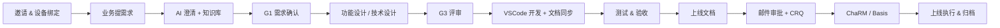

## 1. 账号与设备绑定

### 1.1 目标

- 企业内网、邀请制；账号关联小组。
- 不依赖每次 SSO 登录：一次性链接 + 设备绑定后免登录。
- 更换设备或异常时可自助重新注册，旧设备立即失效。

### 1.2 流程

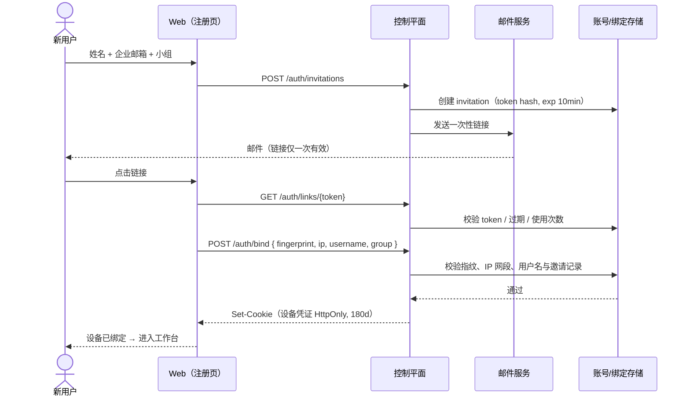

### 1.3 关键规则

| 规则 | 说明 |
| --- | --- |
| 链接有效期 | 10 分钟；只能使用一次 |
| 绑定要素 | 邮箱 + 浏览器指纹 + 访问 IP + 用户名；四者共同生成一次性认证信息 |
| 设备凭证 | HttpOnly Cookie；不随账号同步到其他设备 |
| 免登录 | 后续访问直接识别设备；失效时回到「重新注册」 |
| 重新注册 | 账户菜单 → 重新注册 → 发新链接 → 绑定成功后吊销旧设备 |
| 异常 | 指纹/IP 不匹配时明确提示；不自动重试；记录安全事件 |
| 安全事件 | 绑定、重新注册、指纹不匹配、吊销均写入审计 |

### 1.4 小组归属

- 每个账号只属于一个小组；小组在邀请时确定，之后由管理员调整。
- 小组决定：需求默认可见范围、默认阶段模板、CRQ / ChaRM 模板、通知频道、默认审批人。
- 当前界面不做「切换小组」；侧栏只展示「我的小组」。管理员在管理控制台 `#/admin?tab=groups` 维护小组与成员；普通成员的小组卡进入个人设置 `#/settings?tab=account`，只看只读信息。
- 跨组协作通过任务转交、文档授权或共享链接完成；历史数据保留在原小组归属，不随人员迁移。

### 1.5 小组与成员维护（权限边界）

| 动作 | 平台管理员 | 小组管理员 | 成员 | 系统行为 |
| --- | --- | --- | --- | --- |
| 进入管理控制台 | ● | ●（本组范围） | — | 无权限不显示入口；直接访问渲染无权限页 |
| 新建 / 归档小组 | ● | — | — | 小组 Key 创建后不可改 |
| 邀请成员 | ●（可选小组） | ●（小组锁定本组） | — | 生成邀请，成员进入「待接受」 |
| 调整业务角色 | ● | ●（本组） | — | 不能改自己的业务角色；写审计 |
| 任命 / 取消小组管理员 | ● | ●（本组） | — | 最后一名小组管理员不可移除或降级 |
| 重新发送绑定链接 / 解除设备 | ● | ●（本组） | — | 旧设备立即失效；写安全事件 |
| 移除成员 | ● | ●（本组） | — | 二次确认；历史需求与任务保留 |
| 成员跨组转移 | ● | —（禁用 + 原因） | — | 一人一组的唯一例外；历史归属不迁移；写审计 |

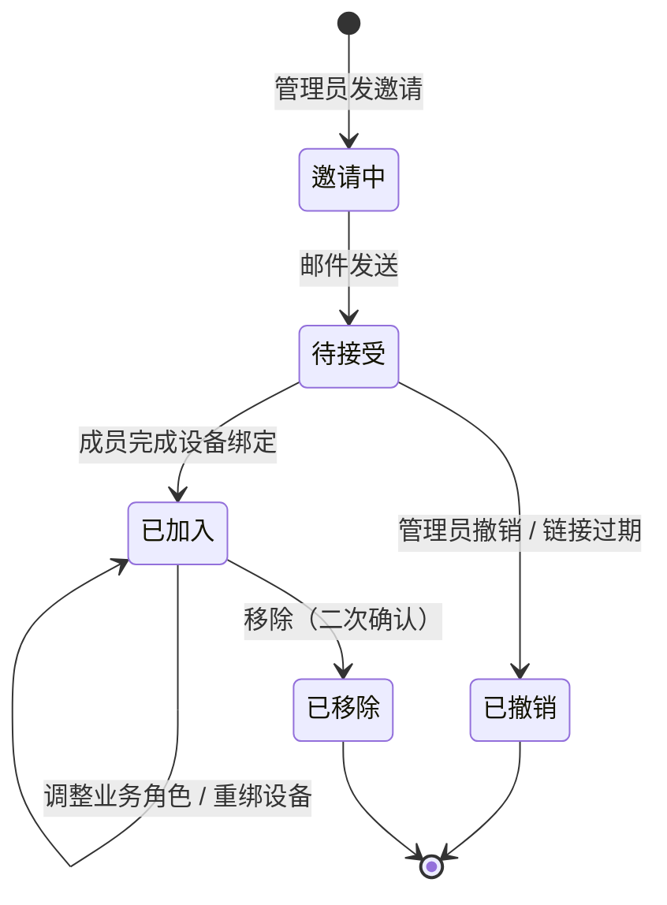

规则：

- 成员变更、管理员任命、跨组转移全部写审计事件：谁、何时、目标、前后值、结果。
- 入口级无权限动作直接隐藏；行内动作仅在目标受限时禁用并给出原因（例如「转移小组」需平台管理员）。
- 小组管理员只能看到本组成员与本组审计；越权请求由服务端拒绝（403），不只是界面隐藏。
- 最后一名小组管理员被移除 / 降级时返回 409，并在界面禁用按钮 + 说明原因。

### 1.6 界面

- [注册 / 账号绑定](../screenshots/auth-welcome.png)
- [设备绑定](../screenshots/auth-bind.png)
- 重新注册：`app.html#/rebind`
- 管理控制台 · 小组与成员：[admin-groups](../screenshots/admin-groups.png)（`app.html#/admin?tab=groups`）

## 2. 需求生命周期

### 2.1 六阶段（PDO 预设）

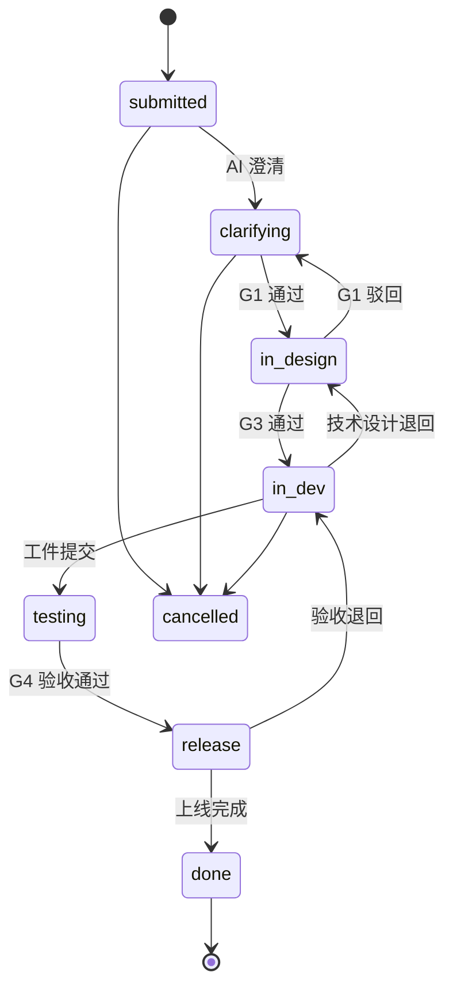

| # | 阶段 | 执行者 | 产出 | 门禁 |
| --- | --- | --- | --- | --- |
| 01 | 需求澄清 | AI + 需求顾问 | 需求分析、澄清问题、验收标准 | G1 顾问确认 |
| 02 | 功能设计 | AI + 顾问 | 功能设计说明、边界场景 | G1 顾问确认 |
| 03 | 技术设计 | AI + 开发 | 技术设计、接口 / 数据说明 | G3 开发评审 |
| 04 | 技术开发 | VSCode 开发者 | 代码变更、PR / 传输 | G3 评审 |
| 05 | 测试 | AI + 测试 | 测试用例、执行证据 | G4 业务验收 |
| 06 | 上线 | IT + 业务 | 上线文档、回滚方案 | 上线审批 + CRQ |

> 规则：一个需求的一个阶段只有一个 StageRun；重试 / 驳回增加 attempt，不新建 StageRun；工件版本只增不减。

### 2.2 阶段推进（门禁）

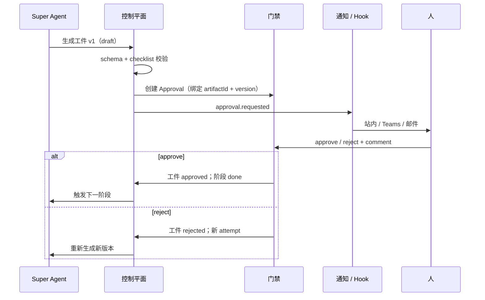

- 审批对象是**具体版本**；上游更新会使下游 `stale`，旧版本上的批准被拒绝。
- 审批超时 → 新 attempt / 转人工；终态不能再次决策（409）。
- 所有决策写入事件日志；详情页展示审批历史。

### 2.3 状态与界面映射

| 业务状态 | 界面表达 | 颜色 |
| --- | --- | --- |
| AI 澄清中 | 需求详情顶部阶段 + 工作台 AI 列表 | teal |
| 待我确认 | 门禁卡 / 待办 | amber |
| 进行中 | 阶段条 / 任务台 | blue |
| 测试中 | 状态 pill | violet |
| 待上线 | 上线窗口 | green |
| 已完成 | 归档 + 时间线 | slate / 绿勾 |
| 失败 / 驳回 | 详情 + 队列 | red |

## 3. AI 澄清与知识库

### 3.1 输入

- 需求标题、描述、附件文本提取。
- 负责人 / 小组 / JIRA 关联。
- 选定知识库来源（PDO 历史需求、开发规范、SOP、接口文档）。
- 相似历史需求（向量 + 规则混合检索）。

### 3.2 输出

- 一段结构化复述（方案理解）。
- 3–6 个澄清问题；每个问题可回答 / 选择。
- 生成的验收标准草稿（每条可追溯）。
- 引用列表（文档、chunk、相关度）。
- 置信度 + 未决问题数。

### 3.3 交互

1. 新建需求第 2 步：AI 先读描述 + 附件，展示「检索 → 理解 → 生成问题 → 等待确认」的链路。
2. 已答问题以绿色勾选展示；未答问题给出选项 chip。
3. 用户可以继续输入补充，AI 实时更新结论。
4. 右侧显示澄清结论、置信度与未决项；可「重新生成」。
5. 确认澄清后进入第 3 步，提交时生成 `requirement_analysis` v1。

### 3.4 边界

- 知识库检索失败：降级为「仅基于需求描述」并明确提示，不编造引用。
- 引用必须可点击回到来源；不展示无法定位的引用。
- AI 输出不作为最终事实，必须经过 G1 人工确认。

## 4. 文档评审与批注

### 4.1 页面结构

| 区域 | 内容 |
| --- | --- |
| 顶部 | 文档标题、版本、状态、作者、评审时限、通过 / 驳回 |
| 左侧 | 目录、批注数 / 未决数 / 引用数、版本历史 |
| 中间 | Markdown 预览 / 源码、行内批注 pin、版本差异、门禁条 |
| 右侧 | 批注列表（作者 / 引用 / 评论 / 解决）、AI 建议、输入框 |
| 顶部 | 「交给 AI 生成新版本」按钮（显示未解决批注数） |

### 4.2 批注流程

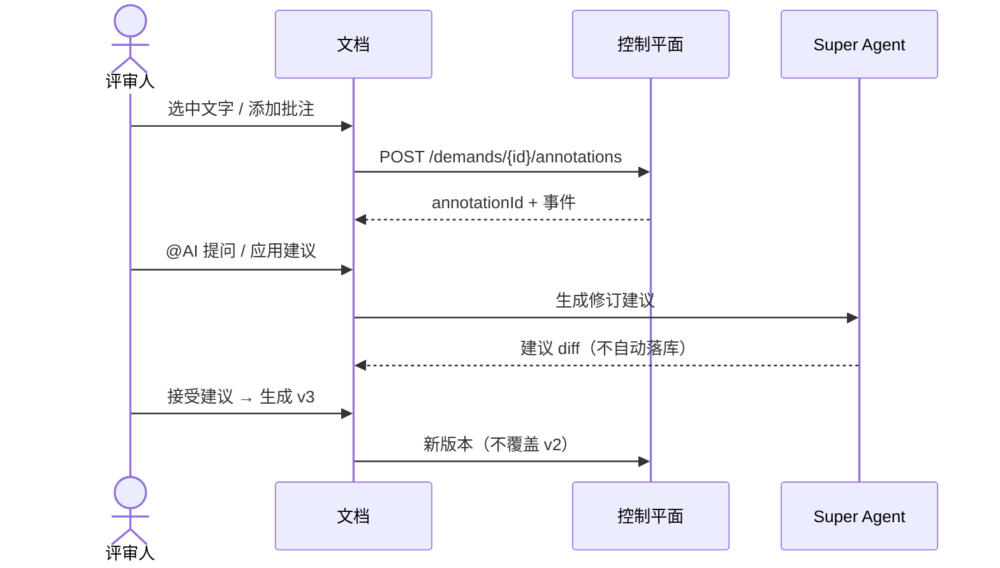

### 4.3 门禁决策

- 门禁条显示 checklist 结果（验收覆盖、引用一致、未决问题）。
- 通过 / 驳回落入同一门禁实例；驳回必须填写原因。
- 通过后阶段推进，文档标记 `approved`；页面跳回需求详情。

### 4.4 版本规则

| 动作 | 结果 |
| --- | --- |
| AI 重新生成 | 新版本，旧版本保留 |
| 人工修改 | 新版本（authorType=human） |
| 接受 AI 建议 | 新版本，显示 diff |
| 上游文档更新 | 下游工件 `stale`，阻断门禁直到重新生成或人工确认 |
| 冲突 | 显式选择服务端 / 本地 / 合并，合并后生成新版本 |

### 4.5 批注 → AI 二次生成（Markdown）

用户批注不是终点，而是下一版文档的输入。

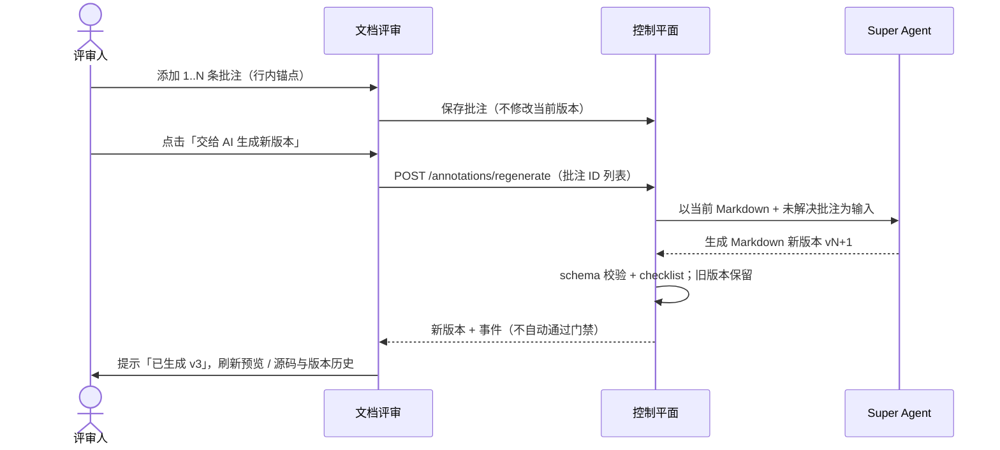

规则：

- AI 只接收**未解决**批注；已解决 / 已忽略的批注不进入上下文。
- 输入与输出都是 Markdown；不生成富文本或 Word。
- 生成结果仍需人工在门禁确认；不得自动通过 G1。
- 一次生成可包含多条批注，生成后逐条标记「已纳入 vN」。
- 失败：保留原版本，提示原因；可重试，不产生半成品版本。

## 5. 任务派发与 VSCode

### 5.1 派发规则

- 任务不预绑定到人：池 + claim + lease（默认 60s，20s 续约）。
- `vscode` 任务要求：在线 + 工作区匹配 + 角色匹配 + 未超过并发。
- `server-ai` 任务不看 presence，7×24 推进。
- 同一用户同一需求最多 1 个活跃人工任务。
- 离线 / 切换工作区 / 暂停接单 → 立即释放任务回池。

### 5.2 开发闭环

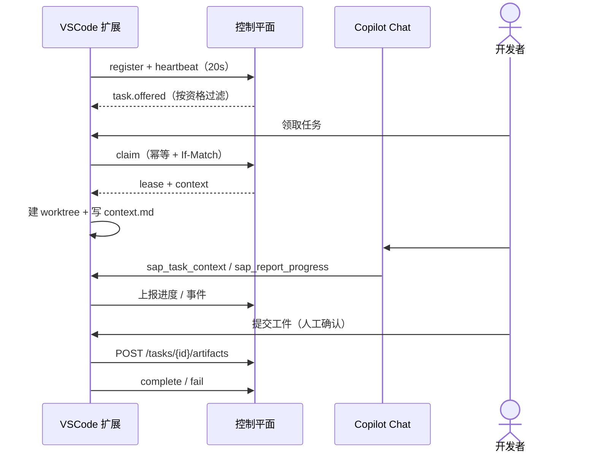

### 5.3 上下文包

`.sap-superagent/task/<taskId>/`

- `context.md`：需求摘要、验收标准、上游工件、工作区绑定、允许 / 禁止动作。
- `context.json`：机器可读快照。
- 附加工件快照。
- **不入库**；整个目录在 `.gitignore` 中。

## 6. CRQ：模板 + 多接口编排

### 6.1 为什么要模板

CRQ 创建接口不完整：需要多次调用不同接口补齐字段。字段还按小组定制、随版本演进。因此把「字段集合 + 默认值 + 下拉来源 + 调用顺序」收敛为模板。

### 6.2 模板模型

| 概念 | 说明 |
| --- | --- |
| 平台基础模板 | 平台管理员维护的基础字段与来源，对全部小组生效；小组只覆盖差异 |
| 小组模板 | 归属单个小组；**其他小组不可见**，页面不提供跨组视图 |
| 版本 | 不可变；发布后生成 schema 快照；已创建工单固定使用创建时版本 |
| 字段 | 名称、类型、来源（默认值 / 当前用户 / ChaRM API / 接口生成 / 手动 / 需求带入）、默认值 |
| 下拉来源 | ChaRM 值列表（`GET /charm/value-help?field=`）拉取后**勾选添加**为选项或设为默认值；也可用静态枚举 / 小组默认值 |
| 编排步骤 | 校验 → 获取请求号 → 创建工单 → 补充字段 → 关联附件 → 提交审批 |

模板按小组隔离：小组管理员只维护本组模板，普通成员只读；平台管理员只多维护一层「平台基础模板」，不做跨组维护。权限细节见 [06 §2.3](06-角色权限与管理.md#23-权限矩阵)。

原型：`app.html#/tools/crq/templates`

### 6.3 创建编排

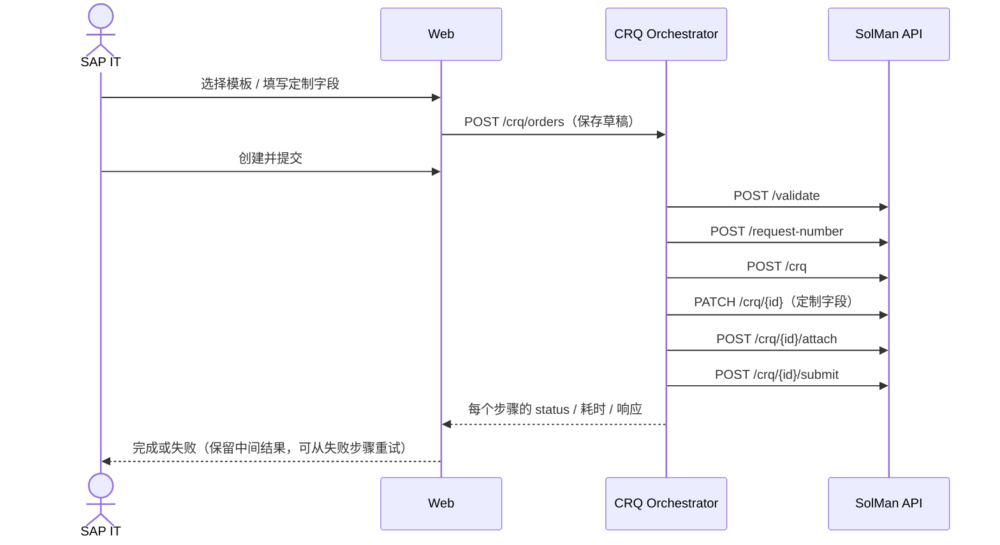

### 6.4 失败语义

| 场景 | 处理 |
| --- | --- |
| 4xx 字段错误 | 立即失败，标记死信，展示具体字段与响应 |
| 5xx / 429 / 超时 | 指数退避重试（2s 起、×2、上限 5min、最多 5 次） |
| 步骤中断 | 保留已成功步骤；从失败步骤重试，不重复创建 |
| 重复点击 | `Idempotency-Key` + 模板版本固定 |
| 审批中 | 工单状态「待审批」，可由业务邮件确认后推进 |

## 7. ChaRM：CR / CD 与 Basis

### 7.1 流程

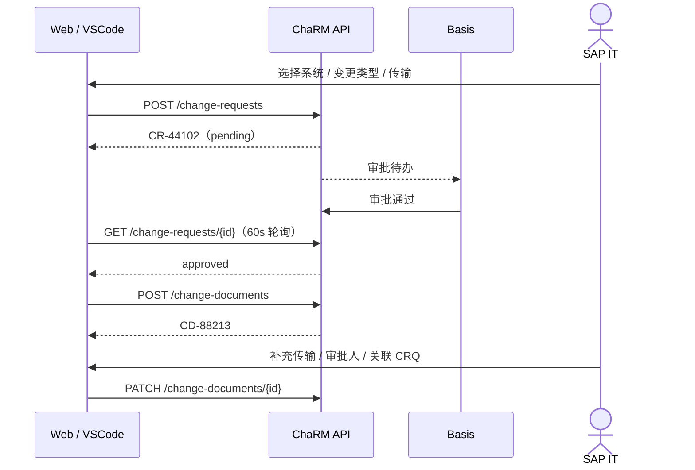

### 7.2 界面规则

- 左侧 Change Document 列表；中间流程时间线 + CR 列表；右侧 Basis 审批与字段。
- 自动同步开关（60s）；手动「拉取状态」立即刷新。
- SSO 只在 VSCode 侧使用：本机 Windows SSO 申请 CR，凭证不上传服务端。
- 审批通过后自动创建 CD，界面显示「自动创建」状态，不需要用户再点一次。

### 7.3 失败与恢复

| 场景 | 处理 |
| --- | --- |
| Basis 驳回 | 状态回到「待修改」，展示审批意见；重新提交生成新 CR |
| 轮询 503 | 指数退避，界面显示「重试中 2/5」 |
| SSO 失效 | VSCode 提示重新登录本机会话；不自动重试写操作 |
| 审批超时 | 通知负责人，可升级 / 撤回 |

## 8. 上线审批与 CRQ 提交

### 8.1 业务规则

- 上线文档必须包含：变更摘要、传输清单、上线步骤、回滚方案、验证清单。
- 上线门禁：文档完整、测试证据、ChaRM 已审批、CRQ 待提交、回滚方案确认。
- 业务方通过**邮件**确认；确认后自动提交 CRQ。
- 提交后进入「等待业务确认」；可查看投递状态与确认时间。

### 8.2 流程

```mermaid
sequenceDiagram
  actor U as SAP IT
  participant W as Web
  participant M as 邮件
  actor B as SAP 业务
  participant Q as CRQ 队列

  U->>W: 提交上线审批
  W->>M: 发确认邮件（含深链）
  W->>Q: 创建 CRQ 草稿（未提交）
  B->>M: 点击确认
  M->>W: 回执 / 深链确认
  W->>Q: 提交 CRQ（幂等）
  Q-->>W: 工单号 / 审批状态
  W-->>U+B: 通知结果
```

- 未确认前不真正提交到 SolMan；邮件发送失败会重试并进入死信。
- 所有邮件与投递事件可在「队列与事件」查看。

## 9. 管理控制台与集成维护

### 9.1 进入与权限

- 管理员从侧栏「管理」组、头像菜单或小组卡进入 `#/admin`；普通成员侧栏没有「管理」组。
- 直接访问 `#/admin` 时渲染无权限页：说明当前账号是普通成员、给出联系人与「返回工作台」，不显示任何管理数据（不静默重定向、不显示半截界面）。
- 页头显示当前管理级别（平台管理员 / 小组管理员）；动作按权限矩阵启用，入口级无权限动作隐藏，目标受限的动作禁用 + 原因。
- 小组管理员在「集成与维护」里只能维护本组参数：小组选择器锁定本组，连接与凭据、Webhook、服务账号只读并说明原因；平台管理员可切换小组维护任意组参数。
- 「小组与成员」tab 的待处理条把「哪个按钮该点」变成「哪里出了问题」：集成需维护 / 邀请待接受；点击落到对应 tab，集成需维护同时打开维护抽屉。

### 9.2 集成状态机

| 状态 | 含义 | 卡片主动作 | 维护抽屉里的主操作 |
| --- | --- | --- | --- |
| 已连接 | 最近调用成功 | 测试连接 | 轮换凭据 / 暂停 / 断开 |
| 同步中 | 正在轮询或批量同步 | 查看同步日志 | 暂停 / 断开 |
| 需处理 | 凭据过期、鉴权失败、连续失败 | 重新授权 | 重新授权 / 查看失败原因 |
| 已停用 | 被管理员暂停 | 恢复 | 恢复 / 断开 |
| 未配置 | 新建但未填凭据 | 配置连接 | 填写连接与凭据 |

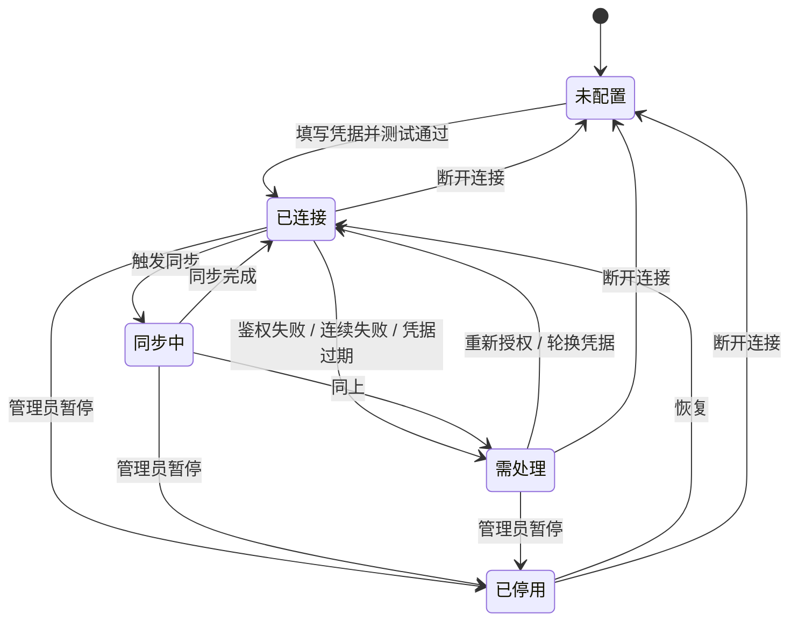

状态决定动作，动作改变状态：不允许出现「已连接」却点不到修复入口的卡片；需处理卡片必须显示错误摘要。

### 9.3 维护流程

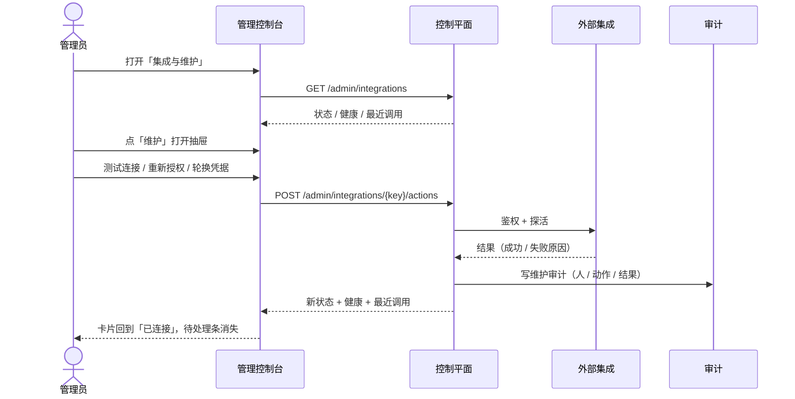

### 9.4 动作与副作用

| 动作 | 前置状态 | 结果状态 | 副作用 |
| --- | --- | --- | --- |
| 测试连接 | 任意 | 不变 | 更新健康与最近调用；失败写错误摘要 |
| 重新授权 | 需处理 | 已连接 | 更新凭据到期时间；写审计 |
| 轮换凭据 | 已连接 / 需处理 | 已连接 | 旧凭据立即失效；写审计 |
| 暂停 | 已连接 / 同步中 / 需处理 | 已停用 | 停止轮询；写审计 |
| 恢复 | 已停用 | 已连接 | 恢复轮询；写审计 |
| 配置连接 | 未配置 | 已连接 / 需处理 | 保存凭据掩码与端点；写审计 |
| 断开连接 | 任意 | 未配置 | 二次确认后清除凭据；写审计 |

所有维护动作：写审计（谁、何时、对哪个集成、做了什么、结果），并回写卡片状态、健康与「最近调用」。

### 9.5 Webhook 与服务账号

- Webhook 订阅：事件 / 目标 / 状态 / 最近投递；新建订阅用弹窗；死信直接链到队列页对应事件。
- 服务账号：账号、作用域、凭据来源、上次轮换；「轮换凭据」仅平台管理员可用。
- 凭据只在服务端使用，界面只显示掩码与到期时间；轮换后旧凭据立即失效。

### 9.6 小组参数维护（两级配置）

集成不是一层设置：**连接与凭据**（端点、认证、凭据、启停、Webhook、服务账号）是平台共享资源，**使用参数**（Helix 工作空间 / 项目 / 工单类型 / 指派组、JIRA Project / Issue 类型 / 同步方向、Teams 频道 / @ 群组、SolMan CRQ 模板 / 请求类型）按小组维护。设计依据见 [06 §4.5](06-角色权限与管理.md#45-两级配置通用连接--小组参数)。

| 角色 | 连接与凭据 | 本组参数 | 其他小组参数 |
| --- | --- | --- | --- |
| 平台管理员 | ● | ● | ●（代为维护，审计标注） |
| 小组管理员 | ○（只读，说明原因） | ●（主责） | —（小组选择器锁定本组） |
| 普通成员 | — | — | — |

**归属与主责**：参数归属小组，主责维护人是该组的小组管理员；平台管理员保留全量兜底能力，维护非本组参数属于「代为维护」，界面提示并写审计。

**继承与覆盖**

- 平台为每个参数给出默认值；小组只覆盖关心的字段，其余显示「继承平台默认」。
- 参数表每行 = 一个集成：本组有效值 chips、来源（已覆盖 N 项 / 继承平台默认）、更新人、维护。
- 参数抽屉逐字段编辑；字段下方常驻「平台默认：X · 继承中 / 本组已覆盖」。保存时只写差异：输入值等于平台默认即视为清除该字段覆盖，不做静默改写。
- 「恢复平台默认」清除该集成在本组的全部覆盖，二次确认后生效。

**影响范围**：只影响本组**新建**对象与默认选择（新建需求、新建 CRQ、通知频道等），不回溯、不改写历史数据；已有对象保留创建时的取值。

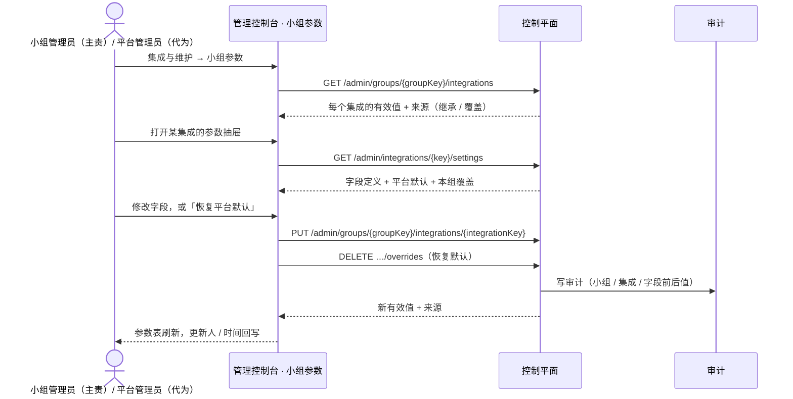

- 小组管理员只能写本组：改他组返回 403，界面在小组选择器与维护按钮上禁用并说明原因。
- 参数变更写审计（对象 = 小组 + 集成 + 字段），与连接维护审计同表；审计中不出现任何凭据。

## 10. 视角切换（SAP 业务 / SAP IT）

### 10.1 两个视角

| 层 | SAP 业务 | SAP IT |
| --- | --- | --- |
| 默认落地 | 总览 `#/home` | 任务台 `#/tasks` |
| 侧栏 | 总览 / 需求 / 待我确认 / 知识库 / 个人设置 | 总览 / 需求 / 任务台 / 文档评审 / CRQ / ChaRM / 队列 / Agent / 知识库 / 个人设置 |
| 总览 | 需求进度、待我确认、上线窗口、AI 运行 | 任务与租约、等待回答、队列健康、Agent 运行 |
| 任务 | 「待我确认」：文档门禁、上线审批、澄清问题 | 「任务台」：可领取 / 进行中 / 等待回答 + VSCode |
| 需求 / 文档 | 我的需求、新建、确认文档；评审通过 / 驳回、批注 | 全部需求、受理、补负责人；技术检查、交给 AI 生成新版本 |
| CRQ / ChaRM | 只读（从需求详情进入） | 创建、编排、Basis 审批 |
| 队列 / Agent | 不可见 | 操作、重试、暂停 |
| 知识库 | 只读 | 维护来源与索引 |

一句话：**业务视角做「提、看、确认」，IT 视角做「接、做、发」。**

### 10.2 切换

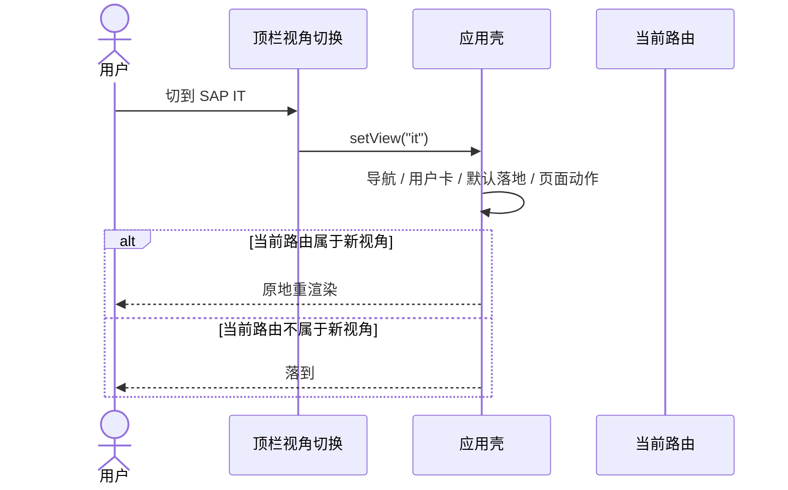

- 双视角账号才显示切换器；单视角账号不显示。切换是视图变化，不获得额外权限。
- 业务视角直接访问 IT 工具页（历史书签 / 深链）分两种处理：可查看页（CRQ 列表、ChaRM、知识库）顶部出现只读条，主操作隐藏，保留筛选 / 搜索 / 详情；不可见页（队列与事件、Agent 运行、新建 CRQ、CRQ 模板）渲染「当前视角不可用」页，给出切换视角与返回工作台。
- 视角切换后若当前路由不在新视角的导航里，落到该视角的默认页；不渲染半截界面。

## 11. 通知、Hook 与队列

### 11.1 事件来源

需求状态、阶段完成、门禁请求 / 决策、工件变化、任务派发 / 领取、CRQ 步骤、ChaRM 审批、Agent 运行、上线审批。

### 11.2 出站队列

| 步骤 | 说明 |
| --- | --- |
| 入队 | 持久事件写入 outbox；同事务 |
| 投递 | 按订阅配置 POST 到目标（Teams / SMTP / JIRA / ChaRM） |
| 重试 | 网络 / 5xx / 429 指数退避；429 尊重 Retry-After |
| 死信 | 4xx / 信封非法 / 超过最大次数；人工重放 |
| 审计 | 每次尝试写 `hook.attempted` / `hook.delivered` / `hook.dead` |
| 回执 | 外部系统异步回执；幂等记录，不重复推进 |

### 11.3 界面

- 队列：名称、类型、深度、速率、workers、最老消息、p95、状态。
- 事件流：实时 tail，按类型过滤，点击查看信封。
- Webhook：状态码、尝试次数、延迟、幂等键、请求 / 响应。
- 外部 API：方法、接口、系统、状态码、延迟、重试、trace。
- 所有失败都有「重试 / 重放」入口，且保留原幂等键。

## 12. Agent 运行

### 12.1 生命周期

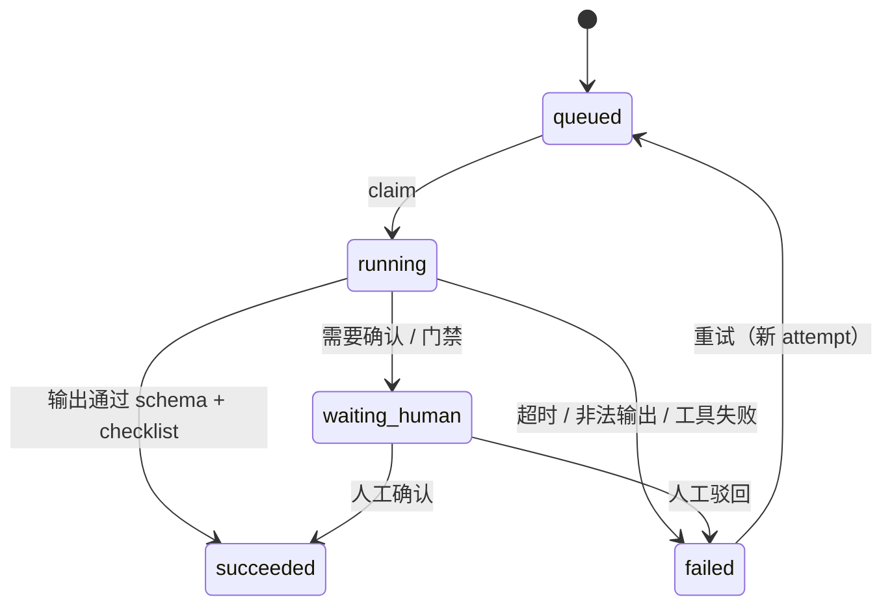

### 12.2 可观测性

每次运行记录：模型、prompt 版本、输入工件版本、tokens、成本、耗时、工具调用、输出摘要、失败原因。界面提供执行计划、工具调用、输出预览与「从检查点重试」。

### 12.3 预算与边界

- 每需求 / 每阶段设置成本上限；超限暂停并转人工，不静默降级。
- 数据边界：模型 Key 只在服务端；prompt / 输出不进入客户端日志。
- Agent 不直接写 SAP 生产系统；写操作需人工确认或走 Hook。

## 13. 失败与恢复矩阵

| 失败点 | 用户看到 | 系统行为 | 恢复动作 |
| --- | --- | --- | --- |
| 一次性链接过期 | 明确提示 + 重新发送 | 旧 token 失效 | 重新发送链接 |
| 指纹 / IP 不匹配 | 拦截页 + 原因 | 写安全事件 | 联系管理员 / 重新注册 |
| AI 输出校验失败 | 运行详情「schema 校验失败」 | 重试 / 转人工，不落半成品 | 从检查点重试 / 人工编辑 |
| 文档冲突 | 同步页并排对比 | 不自动合并 | 选择保留 / 合并 |
| 任务租约过期 | 任务箱提示已回池 | 任务回池，工件保留 | 重新领取 |
| CRQ 接口失败 | 编排步骤标红 + 响应 | 保留中间结果，死信 | 从失败步骤重试 |
| ChaRM 503 | 同步日志「重试 2/5」 | 指数退避 | 自动恢复或人工拉取 |
| 邮件发送失败 | 上线审批状态「投递失败」 | 重试 → 死信 | 重发 / 手动确认 |
| Webhook 4xx | 死信 + payload | 不重试 | 修正配置后重放 |
| 控制平面离线 | VSCode 状态栏红点 | 指数退避重连 | 恢复后 `after=lastSeq` 补齐 |
| 集成需处理（401 / 连续失败） | 卡片错误摘要 + 待处理条 | 暂停轮询，状态置「需处理」并写事件 | 维护抽屉重新授权 / 轮换凭据 |
| 无权限访问 `#/admin` | 无权限页 + 联系人与返回入口 | 不加载管理数据 | 返回工作台 / 由管理员授予权限 |
| 移除最后一名小组管理员 | 按钮禁用 + 原因 | 服务端拒绝变更（409） | 先任命新的小组管理员 |
| 管理动作越权（跨组 / 非本组） | 禁用 + 原因（界面）/ 403 | 不执行，记录拒绝原因 | 由平台管理员执行 |

## 14. 流程验收清单

- [ ] 新用户能在 3 分钟内完成绑定并进入工作台
- [ ] 需求从提交到 G1 的每一步都有界面状态
- [ ] 文档批注与门禁决策可追溯到具体版本
- [ ] 任务从派发到完成不依赖人工转发
- [ ] CRQ 任一步失败都能看到请求 / 响应并重试
- [ ] ChaRM 审批状态无需人工刷新即可更新
- [ ] 上线审批的邮件与 CRQ 提交状态可见
- [ ] 队列 / Agent 的失败有明确恢复动作
- [ ] 普通成员看不到管理入口，直接访问 `#/admin` 显示无权限页
- [ ] 集成任一异常状态都能在维护抽屉里找到修复动作
- [ ] 小组参数能只覆盖关心的字段，其余显示继承平台默认
- [ ] 「恢复平台默认」清除覆盖，且不影响历史对象已使用的取值
- [ ] 成员 / 集成 / 管理员变更都能在审计日志里查到
- [ ] 业务与 IT 视角切换后，导航、默认落地与页面动作一致变化
