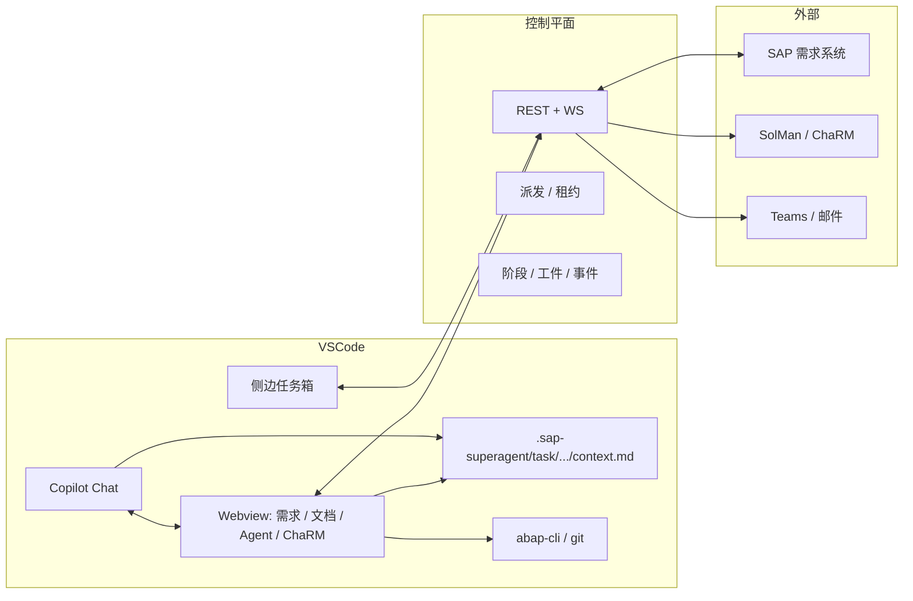

# 04 · VSCode 插件设计

> 定位：**任务客户端 + 本地能力宿主**，不是聊天机器人，也不接管 Copilot Chat。  
> 原型：[`vscode.html`](../vscode.html)（8 个视图，hash 切换）· 截图 [`screenshots/vscode-*.png`](../screenshots/)

## 1. 为什么需要插件

| 需求 | 只在 Web 做不到 | 插件承担 |
| --- | --- | --- |
| 开发在本地 | 代码、git、worktree、abap-cli 在开发者机器 | 任务上下文、worktree、本地命令 |
| 需求上下文 | 服务端有需求与文档，但 Copilot 读不到 | 生成 `context.md` / `context.json`，供 `#file` 引用 |
| 文档同步 | 浏览器与编辑器来回切换 | 拉取 / 推送 / 冲突解决 |
| Agent / Skill | 团队共享的 Agent 需要在 IDE 里生效 | 同步、版本、启停、来源 |
| ChaRM SSO | 用户 Windows 上的 SSO 只在本地 | 本地 SSO 申请 CR，凭据不上传 |
| 在线与租约 | 谁在线、谁能领任务 | 心跳、租约、暂停接单、状态栏 |

## 2. 架构与边界



**边界**

- 控制平面：权限、状态、派发、工件、事件；不接触本地凭据与代码。
- 扩展：任务界面、本地能力、上下文包、SSO；只写控制平面允许的接口。
- Copilot Chat：开发者已有的交互界面；扩展通过 **Extension Tools** + 上下文文件把能力递进去，不控制会话。
- SAP / SolMan：外部系统；通过控制平面或本地 SSO 调用，扩展不直接存业务真相。

## 3. 界面结构

### 3.1 活动栏与侧栏

- 活动栏新增 **SAP Super Agent** 图标（与产品 mark 一致）。
- 侧栏宽 294px，标题 `SAP SUPER AGENT`，右侧刷新 / 更多。
- 顶部连接卡：在线状态、执行器、工作区、心跳、租约、并发。
- 分组（带数量）：
  - **可领取**：按角色 / 工作区过滤；点击行可查看摘要与领取。
  - **我的任务**：当前持有租约的任务；显示剩余租约。
  - **等待我回答**：门禁审批与未读通知；点击直接处理。
  - **已绑定工作区**：z-sales / z-fin；点击切换或绑定。
- 底部：状态、待办数、版本。

**状态**：离线（灰色 + 重连按钮）、暂停接单（状态栏切换）、空（下一步提示）、权限失败（清除 token + 重新授权提示）。

### 3.2 编辑器区域（Webview）

每个视图有独立 tab（如「需求详情 · R-2041」），保留 VS Code 原生 tab 与关闭行为。Webview 使用与 Web 工作台一致的设计语言，但更紧凑：

- 字号 10–22px；控件 26–32px；卡片内边距 10–14px。
- 复用 `.pill` / `.btn` / `.card` / `.progress` 等语义，避免插件里再造一套视觉。

### 3.3 状态栏

左侧：分支、同步状态、错误 / 警告。右侧：`SAP SUPER AGENT · 在线 · 2 待办`、Copilot、语言、编码、行列。

- 点击状态栏可切换「接受派单 / 暂停接单」。
- tooltip 显示待审批门禁数量与下一步动作。
- 离线 / 暂停 / 冲突使用不同颜色与文案（不只变色）。

## 4. 八个视图

### 4.1 任务箱（默认）

**截图**：[vscode-plan](../screenshots/vscode-plan.png)

- **目标**：打开编辑器就知道现在能做什么。
- **内容**：
  - 任务箱页头 + 4 个指标（可领取 / 我的任务 / 等待回答 / 今日完成）。
  - 我的任务卡：T-8841、阶段、租约、进度、上下文已写入、打开任务 / 提交工件。
  - 可领取列表：工作区匹配、领取按钮。
  - 等待我回答：G1 门禁。
  - 右侧：执行器状态、快捷命令。
- **状态**：在线 / 离线 / 暂停；空（没有可领取）。
- **交互**：领取 → 生成上下文包并变「进行中」；打开任务 → 建 worktree；暂停接单。

### 4.2 需求详情

**截图**：[vscode-task](../screenshots/vscode-task.png)

- **目标**：在编辑器里读完整需求上下文，不需要切回浏览器。
- **布局**：页头（R-2041、标题、动作）+ 阶段条 + 主内容（AI 摘要、过程文档、验收标准）+ 右栏（上下文包、任务 / 租约、快速操作）。
- **状态**：文档已同步 / 本地有修改 / 生成中；任务租约剩余时间。
- **交互**：打开文档、复制上下文路径、提交工件、上报进度、释放任务、在浏览器打开。

### 4.3 文档同步

**截图**：[vscode-docs](../screenshots/vscode-docs.png)

- **目标**：让本地与服务端文档的差异可见、可控。
- **布局**：页头动作 + 同步状态 chips（已同步 / 待推送 / 待拉取 / 冲突）+ 文档行 + 同步日志。
- **状态**：每份文档的同步状态与操作（打开 / 查看差异 / 解决冲突）。
- **交互**：全部拉取、推送本地修改、查看 diff、解决冲突。
- **规则**：推送生成新版本，不覆盖历史；目录 `.sap-superagent/task/<taskId>/` 不入库。

### 4.4 Agents & Skills

**截图**：[vscode-agents](../screenshots/vscode-agents.png)

- **目标**：团队共享的 Agent / Skill 与本地草稿都可发现、可管理。
- **布局**：tabs（Agents / Skills）+ 卡片列表（名称、版本、来源、描述、开关）+ 同步来源说明。
- **来源优先级**：服务端 baseline → 仓库 `.github/agents` / `.agents/skills` → 用户覆盖层。
- **状态**：已同步 / 未同步（本地草稿）/ 已停用；可检查更新、同步全部。
- **交互**：启停、同步、查看差异（预留）、推送本地草稿（预留）。

### 4.5 ChaRM & SSO

**截图**：[vscode-charm](../screenshots/vscode-charm.png)

- **目标**：使用本机 Windows SSO 完成 CR 申请，不在浏览器里传凭据。
- **布局**：SSO 状态卡（用户 / 系统 / 会话 / 边界）+ 新建 CR 表单 + 审批时间线 + CD 卡 + 本机能力开关。
- **状态**：SSO 可用 / 不可用；CR 等待 Basis / 已通过；轮询中。
- **交互**：申请 Change Request（需本地 SSO）、保存草稿、自动轮询、通知开关。
- **安全**：凭据可用不可见；扩展只持有本地会话句柄；不写入服务端。

### 4.6 Copilot 协作

**截图**：[vscode-chat](../screenshots/vscode-chat.png)

- **目标**：展示扩展如何把任务「递进」Copilot，而不是另造聊天。
- **布局**：对话流（用户 / Copilot + tool calls）+ 输入框（context chips）。
- **工具调用**：`sap_task_context`、`file_search`、`sap_report_progress`、`edit_file`、`sap_abap_check`。
- **状态**：工具运行中 / 成功 / 失败；写操作需人工确认。
- **降级**：Extension Tools 不可用时，扩展退化为任务客户端 + abap-cli 桥；上下文文件仍可用。

### 4.7 同步与冲突

**截图**：[vscode-sync](../screenshots/vscode-sync.png)

- **目标**：冲突必须由人显式选择，不自动覆盖。
- **布局**：指标 + 并排 diff（服务端 / 本地，绿增红删）+ 操作（使用服务端 / 推送本地 / 手动合并）+ 最近同步。
- **状态**：无冲突 / 冲突 / 已合并。
- **规则**：合并后生成新版本；服务端版本不可变。

### 4.8 状态与命令

**截图**：[vscode-states](../screenshots/vscode-states.png)

- **目标**：集中展示命令、通知、状态栏变体、首次连接与异常。
- **内容**：
  - 命令面板（6 个命令）。
  - 通知 toast（新任务 / 断线 / 工件已推送）。
  - 状态栏变体（在线 / 暂停 / 离线）。
  - 首次连接表单 + 工作区未信任提示。
  - 空状态。
- **命令**：连接控制平面、绑定工作区、领取任务、打开任务（worktree）、提交工件、暂停接单。

## 5. 交互模型

### 5.1 领取任务

1. 侧栏「可领取」→ 点击任务行查看摘要。
2. 领取：`POST /tasks/{id}/claim`（幂等 + If-Match）。
3. 成功：租约 60s，扩展建 worktree、写 `context.md`、打开「需求详情」Webview。
4. 失败（409）：显示当前持有者 / 状态，刷新任务箱，不重试。

### 5.2 上下文包

```text
.sap-superagent/task/<taskId>/
├── context.md          # 需求摘要、验收标准、上游工件、允许/禁止动作
├── context.json        # 机器可读快照
├── functional-design.md
└── tech-design.md
```

- Copilot 中用 `#context.md` 引用。
- 目录写入 `.gitignore`，不提交。
- 服务端工件更新时，扩展提示「可拉取」；不自动覆盖本地修改。

### 5.3 文档同步

- 拉取：服务端 → 本地；若本地有修改，提示保留 / 覆盖 / 另存。
- 推送：本地 → 服务端；生成新版本，附 authorType / 摘要。
- 冲突：并排 diff + 显式选择；合并后生成新版本。

### 5.4 Agent / Skill 同步

- 检查更新：比较版本 hash。
- 同步：下载到 `.github/agents` / `.agents/skills` 或用户目录（按来源）。
- 本地草稿：标记 modified，推送时生成新版本（需人工确认）。
- 启停只影响本机，不影响团队 baseline。

### 5.5 SSO 与 ChaRM

- 启动时检测 SAP Secure Login Client / Windows 会话。
- 「申请 CR」只在本地执行；成功返回 CR 号，再同步到服务端。
- SSO 失效：提示重新登录本地会话；不自动重试写操作。

## 6. 状态与异常

| 场景 | 表现 | 恢复 |
| --- | --- | --- |
| 控制平面离线 | 状态栏红色，任务箱 top 提示 | 指数退避重连；恢复后 `after=lastSeq` |
| 工作区未绑定 | 任务箱空 + 绑定按钮 | 绑定当前工作区 |
| 工作区未信任 | preflight 阻断 | 提示信任工作区 |
| 租约过期 | 任务回池；当前任务不可写 | 重新拉状态 / 重新领取 |
| 同一目录双窗口 | 第二个 claim 409 | 提示已有窗口持有 |
| 权限失败 | 清除 token；停接单 | 重新授权 |
| 文档冲突 | 冲突标记 + diff | 手动合并 |
| SSO 失效 | 提示 | 本地重新登录 |
| Extension Tools 不可用 | 降级提示 | 上下文文件 + 手工回写 |

## 7. 安全

- **凭据可用不可见**：SAP 密码 / SSO 只在本地系统作用域；控制平面与模型上下文不出现。
- **写入范围硬校验**：`allowedSystems[]`（SID/client/生产标记）；生产系统默认只读。
- **写操作人工确认**：`abap push`、`git push`、创建 TR、提交工件需确认。
- **任务内容是不可信数据**：不作为指令；工具白名单 + 参数校验。
- **token 存储**：`SecretStorage`；不写工作区文件。
- **分发**：GitHub Release + VSIX；企业内网可私有更新源。

## 8. 与现有协议的映射

| 界面动作 | 现有接口 / 事件 |
| --- | --- |
| 注册执行器 / 心跳 | `POST /executors/register`、`POST /executors/{id}/heartbeat` |
| 任务箱刷新 | `GET /tasks`、WS `task.offered` / `task.updated` |
| 领取 | `POST /tasks/{id}/claim` |
| 续约 / 释放 | `POST /tasks/{id}/lease/renew`、`POST /tasks/{id}/release` |
| 上下文包 | `GET /tasks/{id}/context` |
| 上报进度 / 提交工件 / 完成 | `POST /tasks/{id}/progress|artifacts|complete` |
| 门禁审批 | `GET /approvals?assignee=me`、`POST /approvals/{id}/decisions` |
| 通知 | `GET /notifications?state=unread`、`POST /notifications/{id}/read` |
| 文档 / 工单 / ChaRM | 新增 API，见 [05-数据与接口.md](05-数据与接口.md) |
| Agent / Skill 同步 | 新增 API（`/extensions/agents`、`/extensions/skills`） |

## 9. 验收清单

- [ ] 打开 VSCode 后 3 秒内显示任务箱（或明确的连接状态）
- [ ] 领取任务后自动生成 worktree 与上下文包
- [ ] Copilot 可通过 `#context.md` 读取任务
- [ ] 任务租约状态在状态栏实时可见
- [ ] 文档拉取 / 推送 / 冲突都可控
- [ ] Agent / Skill 版本与来源可见、可启停
- [ ] 本机 SSO 申请 CR 不经过服务端凭据
- [ ] 离线 / 权限失败 / 未信任工作区有明确恢复动作
- [ ] 写操作必须人工确认
- [ ] 无 Marketplace 也可通过 VSIX 安装
