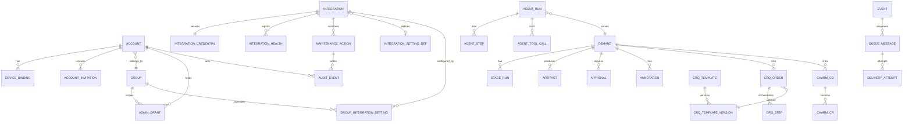

# 05 · 数据模型与接口

> 本文件描述界面背后的数据对象、状态、事件与接口约定。已有对象（Demand / StageRun / Task / Assignment / Artifact / Approval / Event / Hook）沿用现有 `docs/003-domain-and-protocol.md` 与 `docs/008-hooks.md`；本文只定义**本次重构新增或显式化**的部分。
>
> 原则：外部系统的实体沿用外部 ID；控制平面内部实体使用 ULID；所有写操作可幂等；工件与模板版本不可变。

## 1. 领域对象总览



## 2. 账号、小组与设备绑定

### 2.0 Account

| 字段 | 说明 |
| --- | --- |
| `accountId` | 账号 |
| `email` / `name` | 企业邮箱 / 姓名 |
| `groupKey` | **唯一所属小组**；一个账号只属于一个小组 |
| `businessRole` | 业务角色（单值，对应设计模型里的 `role`）：`business / consultant / developer / tester / basis`；由小组关系决定，小组管理员调整 |
| `views[]` | 工作视角：`business` / `it`；双视角账号可在顶栏切换，单视角账号不显示切换器 |
| `adminLevel` | 管理权限：`platform / group / none`；`group` 时由 `adminGroups[]` 限定范围（原型字段名 `admin`，取 `platform / group / null`） |
| `status` | `invited / active / disabled` |

**约束**

- 业务角色、工作视角、管理权限三层独立：视角是视图，不携带权限；管理权限不隐含在业务角色里。
- `account.groupKey` 单值，不允许数组；调整小组必须由平台管理员执行并写审计事件（单组模型的唯一例外）。
- 小组决定需求默认可见范围、默认阶段模板、CRQ / ChaRM 模板与通知频道。
- 跨组协作使用任务转交 / 文档授权，不共享账号归属。
- 历史 Demand / Task 保留创建时的小组归属，不随人员调整而迁移。
- 成员变更（邀请 / 业务角色 / 管理员任命 / 移除 / 转移）必须写 `AuditEvent`；管理权限与业务角色分开授予。

### 2.1 Group

| 字段 | 说明 |
| --- | --- |
| `groupKey` | 小组 Key（如 `FIN-SH`）；创建后不可改 |
| `name` | 小组名 |
| `status` | `active / archived` |
| `memberCount` | 成员数（含待接受邀请） |
| `adminAccountIds[]` | 本组管理员；由 AdminGrant 计算，至少一名 |
| `defaultTemplateId` / `defaultTemplateVersion` | 默认阶段模板；只影响新建需求 |
| `defaultApproverId` | 默认审批人 |
| `createdAt` / `archivedAt` | |

- 小组管理员只能管理本组；「管理全部小组」只对平台管理员开放。
- 归档小组不删除历史数据；成员与需求保留只读。
- 默认模板 / 默认审批人只影响新建对象，不回溯历史。

### 2.2 AccountInvitation

| 字段 | 类型 | 说明 |
| --- | --- | --- |
| `id` | ULID | 邀请 ID |
| `email` | string | 企业邮箱 |
| `groupKey` | string | 关联小组；小组管理员邀请时锁定为本组 |
| `businessRoleHint` | string | 建议业务角色（见 `Account.businessRole`） |
| `views[]` | string[] | 授予的工作视角；双视角可同时勾选 |
| `tokenHash` | string | 一次性链接 token 的 hash（不存明文） |
| `expiresAt` | datetime | 默认 10 分钟 |
| `usedAt` | datetime? | 使用后置位；只能用一次 |
| `invitedBy` | string | 邀请人 |
| `createdAt` | datetime | |
| `revokedAt` | datetime? | 管理员撤销 |

> 成员进入「待接受」后，可重发邀请或撤销；状态流转见 [02-关键流程.md §1.5](02-关键流程.md#15-小组与成员维护权限边界)。

### 2.3 DeviceBinding

| 字段 | 类型 | 说明 |
| --- | --- | --- |
| `id` | ULID | 设备绑定 ID |
| `accountId` | string | 账号 |
| `fingerprintHash` | string | 浏览器指纹 hash（不存原始指纹） |
| `ipHash` / `ipPrefix` | string | 访问 IP（按合规要求存储） |
| `userAgent` | string | 设备 / 浏览器 |
| `deviceLabel` | string | 展示用（MacBook Pro · Chrome 156） |
| `credentialHash` | string | 设备凭证 hash；Cookie 只存随机值 |
| `status` | enum | `active / revoked / expired` |
| `expiresAt` | datetime | 默认 180 天 |
| `lastSeenAt` | datetime | |
| `revokedAt` | datetime? | 重新注册或管理员吊销 |
| `createdAt` | datetime | |

**规则**

- 同一账号可有多条历史绑定，但只有一条 `active`。
- 重新注册创建新绑定并吊销旧绑定（同一事务）。
- 指纹 / IP 不匹配时创建安全事件，不自动放行。

### 2.4 SecurityEvent

`kind`: `invitation_sent / link_used / bind_success / fingerprint_mismatch / re_binding / device_revoked / token_cleared`；记录 actor、IP、fingerprint hash、结果与时间。

## 3. 管理权限、集成与审计

### 3.1 AdminGrant

| 字段 | 说明 |
| --- | --- |
| `id` | ULID |
| `accountId` | 被授予人 |
| `scope` | `platform / group` |
| `groupKey` | `scope=group` 时必填 |
| `grantedBy` / `grantedAt` | 授予人 / 时间 |
| `revokedBy` / `revokedAt` | 取消时置位 |
| `reason` | 可选，随审计记录 |

- 平台管理员可授予 / 取消任意 AdminGrant；小组管理员可任命 / 取消本组管理员。
- 不能修改自己的管理权限；最后一名小组管理员不可移除或降级（409）。
- 管理权限与业务角色独立；授予 / 取消写审计（`admin.granted` / `admin.revoked`）。

### 3.2 Integration

| 字段 | 说明 |
| --- | --- |
| `key` | 平台级集成：`teams / smtp / jira / solman / charm / ai-gateway` 等 |
| `name` / `category` | 展示名 / 分类（协作、邮件、工单、变更、AI） |
| `status` | `connected / syncing / attention / paused / unconfigured` |
| `description` | 一句话说明 |
| `endpoint` / `clientId` / `authType` | 连接信息；凭据单独存 |
| `ownerAccountId` | 维护人 |
| `lastCallAt` | 最近调用 |
| `errorSummary` | 需处理时的错误摘要（如「401 凭据已过期 · 同步已暂停 3 小时」） |
| `createdAt` / `updatedAt` | |

| 状态 | 含义 | 卡片主动作 | 维护抽屉主操作 |
| --- | --- | --- | --- |
| `connected` 已连接 | 最近调用成功 | 测试连接 | 轮换凭据 / 暂停 / 断开 |
| `syncing` 同步中 | 正在轮询或批量同步 | 查看同步日志 | 暂停 / 断开 |
| `attention` 需处理 | 凭据过期、鉴权失败、连续失败 | 重新授权 | 重新授权 / 查看失败原因 |
| `paused` 已停用 | 被管理员暂停 | 恢复 | 恢复 / 断开 |
| `unconfigured` 未配置 | 新建但未填凭据 | 配置连接 | 填写连接与凭据 |

- 状态决定动作，动作改变状态；不允许出现「已连接」却点不到修复入口的卡片。
- **连接与凭据是平台级资源**：小组管理员只读，维护仅平台管理员；「连上之后怎么用」的使用参数按小组维护，见 §3.8。
- 状态变化写事件 `integration.status_changed`，并随维护动作写审计。

### 3.3 IntegrationCredential

| 字段 | 说明 |
| --- | --- |
| `integrationKey` | 所属集成 |
| `type` | `oauth / app_password / client_secret / certificate` |
| `maskedValue` | 展示用掩码；API 永不返回明文 |
| `secretRef` | 服务端 secret 引用；不下发客户端 |
| `lastRotatedAt` / `expiresAt` | 上次轮换 / 到期时间 |
| `rotatedBy` | 最近轮换人 |

- 轮换后旧凭据立即失效；轮换写审计，审计中同样只出现掩码。
- 到期时间展示在维护抽屉；到期前由平台管理员轮换（原型不单独提供到期提醒）。

### 3.4 IntegrationHealth

| 字段 | 说明 |
| --- | --- |
| `integrationKey` | 所属集成 |
| `successRate24h` | 24h 成功率 |
| `consecutiveFailures` | 连续失败次数 |
| `lastError` | `{code, message, at}`（脱敏） |
| `nextPollAt` | 下次轮询时间 |
| `recentCalls[]` | 最近 5 条：`{at, operation, result, latencyMs}` |
| `checkedAt` | 最近检测时间 |

### 3.5 MaintenanceAction

| 字段 | 说明 |
| --- | --- |
| `id` | ULID |
| `integrationKey` | 所属集成 |
| `action` | `test_connection / reauthorize / rotate_credential / configure / pause / resume / disconnect` |
| `actorId` | 操作人 |
| `status` | `pending / succeeded / failed` |
| `resultSummary` | 结果或失败原因（脱敏） |
| `confirmedAt` | 断开等破坏性动作的二次确认时间 |
| `startedAt` / `finishedAt` | |
| `auditEventId` | 对应审计事件 |

- 动作成功回写 `Integration.status`、`IntegrationHealth` 与 `recentCalls`；失败只更新健康与错误摘要（断开除外）。
- 每个动作写一条审计；接口带幂等键，防止重复点击产生重复副作用。

### 3.6 AuditEvent

| 字段 | 说明 |
| --- | --- |
| `id` | ULID |
| `at` | 时间 |
| `actorId` / `actorType` | 操作人 / `human` 或 `system` |
| `action` | `member.invited / member.role_changed / member.admin_changed / member.removed / member.transferred / admin.granted / admin.revoked / group.updated / integration.maintenance / integration.credential_rotated / integration.settings_updated` |
| `subjectType` / `subjectId` | `account / group / integration / credential` |
| `scopeGroupKey` | 小组范围；平台级操作为空 |
| `before` / `after` | 变更前后摘要（不含凭据明文） |
| `result` | `succeeded / failed / denied` |
| `requestId` | 关联请求 / 幂等键 |

- 只追加、不可编辑、不可删除；平台管理员看全量，小组管理员只读本组。
- 保留 ≥ 1 年（合规）；界面按对象 / 操作人 / 时间过滤。

### 3.7 WebhookSubscription / ServiceAccount

| 对象 | 字段 |
| --- | --- |
| `WebhookSubscription` | `id`、`events[]`、`targetUrl`、`secretRef`、`status`（`active / paused / attention`）、`lastDeliveryAt`、`deadLetterCount` |
| `ServiceAccount` | `id`、`name`、`scopes[]`、`credentialRef`、`lastRotatedAt` |

- 两者都是平台级资源；Webhook 死信链到队列页对应事件，服务账号凭据只轮换、不下发客户端。

### 3.8 IntegrationSettingDef / GroupIntegrationSetting

两级配置的存储模型：平台默认值定义与小组覆盖分开，小组只存差异。

**IntegrationSettingDef**（平台默认值定义）

| 字段 | 说明 |
| --- | --- |
| `integrationKey` | 所属集成（`helix / jira / teams / solman / …`） |
| `fields[]` | 参数定义：`{key, label, type(text / select), options[], defaultValue, required}` |
| `updatedBy` / `updatedAt` | 平台默认值的最近修改人与时间 |

- 一个集成一份定义；字段 `key` 创建后不可改名，避免小组覆盖失配。
- 平台默认值只是「继承」的取值来源，不等于各小组的生效值。

**GroupIntegrationSetting**（小组覆盖）

| 字段 | 说明 |
| --- | --- |
| `groupKey` / `integrationKey` | 复合主键 |
| `values{}` | 已覆盖字段的取值，只存差异，不冗余平台默认 |
| `overriddenKeys[]` | 当前被覆盖的字段 key，供「已覆盖 N 项 / 继承平台默认」直接读取 |
| `updatedBy` / `updatedAt` | 最近修改人与时间 |

**继承语义**

- 有效值 = `values[key]` 存在则取小组值，否则取 `fields[key].defaultValue`（继承平台默认）。
- 保存时只写差异：输入值等于平台默认即删除该 key（视为不再覆盖），不写冗余值。
- 「恢复平台默认」= 删除该 `(groupKey, integrationKey)` 的覆盖；不静默改写历史对象。
- 参数只影响本组**新建**对象与默认选择，已有对象保留创建时的取值。
- 变更写审计（`integration.settings_updated`，对象 = 小组 + 集成，before / after 只含参数值）；小组参数中不出现任何密钥。

## 4. 需求扩展

在现有 Demand 上增加界面需要的投影字段（存储仍以 SAP 为准，控制平面做快照）：

| 字段 | 说明 |
| --- | --- |
| `jiraKey` | JIRA Issue / Epic 号，可空 |
| `groupKey` | 所属小组 |
| `owners[]` | 负责人（多选，含角色） |
| `templateId` / `templateVersion` | 创建时固定 |
| `releaseWindow` | 期望 / 锁定上线窗口 |
| `backlogRank` | JIRA Backlog 排序（可空） |
| `releaseDocVersion` | 当前上线文档版本（可空） |

> 阶段、工件、门禁、任务继续使用原对象；界面只读投影，不新增第二套状态。

## 5. 文档批注与版本

### 5.1 Annotation

| 字段 | 类型 | 说明 |
| --- | --- | --- |
| `id` | ULID | |
| `demandId` / `artifactKind` / `artifactVersion` | | 绑定到具体版本 |
| `anchor` | object | 段落 / 行 / 文本片段 + 前后文 hash |
| `authorId` | string | |
| `body` | markdown | 批注内容 |
| `mentions[]` | string[] | @ 的人 |
| `status` | enum | `open / resolved` |
| `resolvedBy` / `resolvedAt` | | |
| `replies[]` | object[] | 简化线程 |
| `createdAt` | datetime | |

- 批注不修改工件内容；接受建议或交给 AI 时生成新版本。
- 解析锚点时若文本已变化，显示「原文已变更」而不是错位高亮。
- **AI 二次生成**：`POST /annotations/regenerate` 接收未解决批注 ID 列表；AI 以当前 Markdown 为输入生成 vN+1。生成结果不自动通过门禁，原版本保留。
- **文档格式**：当前只支持 Markdown（`contentType: text/markdown`），不做富文本 / Word 双向编辑。

### 5.2 版本规则（沿用 003）

- `artifactId` 不变，`version` 递增；旧版本永久保留。
- `authorType`: `ai / human / agent / import`。
- 本设计范围内，AI 生成与人工编辑的过程文档统一为 `text/markdown`；界面负责渲染、批注与版本对比。
- `stale` 标记在版本级；上游新版本会阻断下游门禁。
- 冲突合并生成新版本，不覆盖服务端版本。

## 6. CRQ

### 6.1 CRQTemplate / CRQTemplateVersion

| 字段 | 说明 |
| --- | --- |
| `templateId` | 模板 ID |
| `scope` | `platform_base / group`；基础模板对全部小组生效，小组模板按小组隔离 |
| `groupKey` | 小组模板必填；平台基础模板为空 |
| `name` | 展示名 |
| `version` | 整数版本 |
| `status` | `draft / published / archived` |
| `fieldSchema` | 字段定义（名称、类型、来源、默认值、`options[]`、校验）；下拉字段的 `options[]` 与 `defaultValue` 可从 ChaRM 值列表拉取后勾选维护 |
| `orchestration` | 步骤顺序与接口映射 |
| `createdBy` / `publishedBy` / `publishedAt` | |
| `schemaHash` | 版本快照 hash |

**字段来源枚举**：`default / currentUser / charmApi / apiGenerated / manual / autoFromDemand`。

**隔离规则**：接口只返回当前账号可见的模板——小组模板按 `groupKey` 隔离、其他小组不可见；平台基础模板只有平台管理员可读写，小组侧只继承不展示列表。

### 6.2 CRQOrder

| 字段 | 说明 |
| --- | --- |
| `id` | 内部 ULID；`crqNo` 为 SolMan 返回号 |
| `demandId` | 关联需求 |
| `groupKey` / `templateId` / `templateVersion` | 固定创建时版本 |
| `status` | `draft / running / pending_approval / created / failed / cancelled` |
| `fields` | 填写的字段快照 |
| `requestNo` | 请求号（接口生成） |
| `externalId` | SolMan CRQ 号 |
| `idempotencyKey` | 创建幂等键 |
| `createdBy` / `createdAt` | |

### 6.3 CRQStep

| 字段 | 说明 |
| --- | --- |
| `orderId` / `seq` / `key` | 步骤 |
| `status` | `pending / running / succeeded / failed / skipped` |
| `request` | 脱敏后的请求（method / path / body 摘要） |
| `response` | 状态码、耗时、外部 ID、错误摘要 |
| `attempt` / `startedAt` / `finishedAt` | |
| `deadLetter` | 是否进入死信 |

## 7. ChaRM

### 7.1 CharmChangeRequest

| 字段 | 说明 |
| --- | --- |
| `id` | `CR-xxxxx`（外部 ID） |
| `changeDocumentId` | 所属 CD |
| `system` / `client` | 目标系统 |
| `type` | Normal / Urgent / Config |
| `status` | `draft / pending_basis / approved / rejected / cancelled` |
| `transports[]` | 传输号 |
| `basisApprover` | 从 ChaRM 拉取 |
| `submittedAt` / `approvedAt` | |
| `polledAt` | 最近轮询时间 |

### 7.2 CharmChangeDocument

| 字段 | 说明 |
| --- | --- |
| `id` | `CD-xxxxx` |
| `demandId` / `crqId` | 关联 |
| `system` / `client` | |
| `status` | `draft / pending_basis / created / closed` |
| `owner` | 负责人 |
| `changeRequests[]` | CR 列表 |
| `syncLog` | 最近轮询摘要 |

### 7.3 轮询

- 默认 60s；手动「拉取状态」立即触发。
- 503 / 超时：指数退避，记录到同步日志；不改变本地状态。
- 审批通过：自动创建 CD（幂等），写事件与通知。

## 8. 队列、Hook 与投递

### 8.1 QueueMessage (outbox)

| 字段 | 说明 |
| --- | --- |
| `id` | ULID |
| `queue` | `teams-notify / smtp-approval / jira-sync / charm-poll / crq-orchestrator / ai-stage-runner / dead-letter` |
| `kind` | `hook / api / ai / dlq` |
| `eventId` / `eventType` | 源事件 |
| `payloadRef` / `payload` | 信封或请求摘要 |
| `idempotencyKey` | 重放不变 |
| `status` | `pending / inflight / sent / dead / cancelled` |
| `attempts` | 次数 |
| `nextAttemptAt` | 退避时间 |
| `lastError` | 脱敏错误 |
| `createdAt` / `updatedAt` | |

### 8.2 DeliveryAttempt

`messageId`, `attempt`, `statusCode`, `latencyMs`, `error`, `responseSummary`, `startedAt`。

### 8.3 重试与死信

| 类别 | 处理 |
| --- | --- |
| 网络 / 5xx / 429 | 指数退避：2s 起、×2、上限 5min、最多 5 次；429 尊重 Retry-After |
| 4xx / 信封非法 | 立即死信，不可自动重试 |
| 死信 | 人工重放，保持幂等键；记录操作人 |
| 回执 | 幂等落库；重复回执不重复写事件 |
| 对账 | 每日比对：外部有 / 内部无；内部已发 / 外部无；死信未处理 |

## 9. Agent 运行

### 9.1 AgentRun

| 字段 | 说明 |
| --- | --- |
| `id` | ULID |
| `demandId` / `stageRunId` / `stageKey` | 服务对象 |
| `status` | `queued / running / waiting_human / succeeded / failed / cancelled` |
| `model` / `promptVersion` | 可复现 |
| `inputArtifacts[]` | `{artifactId, version}` |
| `tokensIn` / `tokensOut` / `costUsd` | 记账 |
| `durationMs` | |
| `outputArtifactId` / `outputVersion` | 成功时 |
| `error` | `{code, message, retryable}` |
| `attempt` | 阶段内尝试次数 |
| `startedAt` / `finishedAt` | |

### 9.2 AgentStep / AgentToolCall

- Step：`retrieve / assemble_context / generate / validate / submit_gate`，含状态、耗时、摘要。
- ToolCall：`tool`, `argsSummary`, `status`, `latency`, `resultSummary`；不存完整 prompt / 敏感内容。

## 10. 扩展（Agent / Skill）与同步

### 10.1 ExtensionArtifact

| 字段 | 说明 |
| --- | --- |
| `kind` | `agent / skill` |
| `name` | `sap-developer` / `sap-dev` |
| `version` | 语义化版本或 hash |
| `source` | `server / repo-agents / repo-skills / user` |
| `channel` | `baseline / draft` |
| `contentRef` / `checksum` | |
| `enabled` | 团队默认 / 用户覆盖 |
| `updatedAt` | |

### 10.2 SyncState

`workspaceKey`, `kind`, `name`, `localVersion`, `remoteVersion`, `status`（`synced / modified / remote_ahead / conflict`）, `lastSyncedAt`。

## 11. 事件

### 11.1 Envelope（沿用 003 §4.4）

```json
{
  "seq": 12043,
  "id": "01J8ZQ9W3K5M2V7X4C6B8N0P1Q",
  "type": "crq.step.succeeded",
  "at": "2026-11-11T12:04:03Z",
  "subject": { "type": "crq_order", "id": "01J8...", "demandId": "R-2041" },
  "data": { "step": "create", "externalId": "CRQ-2026-0842" }
}
```

### 11.2 新增 / 界面依赖的事件

| type | subject | 用途 |
| --- | --- | --- |
| `account.invited` | account | 邀请发送 |
| `device.bound` / `device.revoked` | device | 设备绑定 / 吊销 |
| `annotation.created` / `annotation.resolved` | annotation | 批注 |
| `annotation.regenerated` | annotation | 批注交给 AI 生成新版本 |
| `group.updated` | group | 小组规则 / 默认模板 |
| `member.invited` / `member.role_changed` / `member.admin_changed` / `member.removed` / `member.transferred` | account | 成员维护（写审计） |
| `admin.granted` / `admin.revoked` | account | 管理权限授予 / 取消 |
| `integration.status_changed` / `integration.credential_rotated` / `integration.maintenance` / `integration.settings_updated` | integration | 集成状态、维护与小组参数变更（写审计） |
| `doc.synced` / `doc.conflict` | artifact | 文档同步 |
| `crq.step.started/succeeded/failed` | crq_order | 编排步骤 |
| `crq.order.status_changed` | crq_order | 工单状态 |
| `charm.pending_basis` / `charm.approved` / `charm.cd_created` | charm_cd | ChaRM |
| `release.email_sent` / `release.confirmed` | demand | 上线审批 |
| `queue.dead_letter` / `queue.replayed` | queue_message | 队列 |
| `agent.run.started/step/tool/finished` | agent_run | Agent 运行 |
| `extension.synced` / `extension.conflict` | extension | 插件同步 |

> 事件只追加；界面通过 WS 增量推送 + `after=lastSeq` 补齐，不轮询整页。

## 12. REST 接口

管理端接口统一校验能力（`admin.access` / `admin.groups.*` / `admin.members.*` / `admin.integrations.manage` / `admin.audit.view`）：越权 403，最后一名管理员保护 409，只返回当前管理范围的数据；界面隐藏不作为安全边界。

### 12.1 账号与设备

| 方法 | 路径 | 说明 |
| --- | --- | --- |
| POST | `/auth/invitations` | 发邀请（自助注册 / 管理端邀请复用） |
| GET | `/auth/links/{token}` | 校验一次性链接 |
| POST | `/auth/bind` | 绑定设备（指纹 / IP / 用户名） |
| POST | `/auth/rebind` | 重新注册（吊销旧设备） |
| DELETE | `/devices/{id}` | 解除绑定 |
| GET | `/devices` | 当前账号设备 |
| GET | `/security/events` | 安全事件 |

### 12.2 管理与集成

| 方法 | 路径 | 说明 |
| --- | --- | --- |
| GET | `/admin/groups` | 小组列表（平台管理员全部；小组管理员本组） |
| POST | `/admin/groups` | 新建小组（仅平台管理员） |
| PATCH | `/admin/groups/{groupKey}` | 名称 / 默认模板 / 默认审批人（Key 不可改） |
| POST | `/admin/groups/{groupKey}/archive` | 归档小组 |
| GET | `/admin/groups/{groupKey}/members` | 成员表（含管理权限 / 待接受） |
| POST | `/admin/members/invite` | 邀请成员（小组管理员的小组锁定为本组） |
| POST | `/admin/members/{accountId}/resend-invite` | 重发邀请 / 绑定链接 |
| PATCH | `/admin/members/{accountId}/role` | 调整业务角色（不能改自己） |
| PATCH | `/admin/members/{accountId}/admin` | 任命 / 取消小组管理员（最后一名 409） |
| POST | `/admin/members/{accountId}/transfer` | 跨组转移（仅平台管理员；历史归属不迁移） |
| DELETE | `/admin/members/{accountId}` | 移除成员（二次确认；历史需求保留） |
| DELETE | `/admin/devices/{id}` | 解除设备绑定 |
| GET | `/admin/audit?scope=&actor=&from=&to=` | 审计日志（平台全量；小组本组） |
| GET | `/admin/integrations` | 集成列表（状态 / 健康摘要） |
| GET | `/admin/integrations/{key}` | 详情 + 凭据掩码 + 健康 + 最近调用 |
| GET | `/admin/integrations/{key}/settings` | 平台默认值定义 + 各小组覆盖摘要（平台管理员；小组管理员只读本组） |
| GET | `/admin/groups/{groupKey}/integrations` | 本组各集成的有效参数 + 来源（继承 / 覆盖） |
| GET | `/admin/groups/{groupKey}/integrations/{integrationKey}` | 单个集成的有效值、平台默认、覆盖字段与更新人 |
| PUT | `/admin/groups/{groupKey}/integrations/{integrationKey}` | 保存本组覆盖（只传差异；写审计） |
| DELETE | `/admin/groups/{groupKey}/integrations/{integrationKey}/overrides` | 恢复平台默认（清除本组覆盖；写审计） |
| POST | `/admin/integrations/{key}/actions` | 测试 / 重新授权 / 轮换 / 配置 / 暂停 / 恢复 / 断开（幂等） |
| GET | `/admin/webhooks` | Webhook 订阅 |
| POST | `/admin/webhooks` | 新建订阅 |
| GET | `/admin/service-accounts` | 服务账号 |
| POST | `/admin/service-accounts/{id}/rotate` | 轮换服务账号凭据 |

- 连接与凭据相关写接口（`/admin/integrations/{key}/actions`、Webhook、服务账号轮换）要求 `admin.integrations.manage`（平台管理员）；小组管理员只读。
- 小组参数写接口（`PUT` 与 `DELETE …/overrides`）要求 `admin.groups.manage` 且 `groupKey` 在本人管理范围内；小组管理员改他组返回 403，不能只靠界面隐藏。
- 所有集成写操作带幂等键并写审计（`integration.maintenance` / `integration.credential_rotated` / `integration.settings_updated`）。

### 12.3 需求与文档

| 方法 | 路径 | 说明 |
| --- | --- | --- |
| GET | `/demands?status=&group=&owner=&q=` | 列表 / Backlog |
| POST | `/demands` | 创建（含负责人多选、附件、JIRA） |
| GET | `/demands/{id}` | 阶段、工件、门禁、关联单据 |
| POST | `/demands/{id}/artifacts` | 人工新版本 |
| GET | `/demands/{id}/annotations` | 批注 |
| POST | `/demands/{id}/annotations` | 新建批注 |
| POST | `/annotations/{id}/resolve` | 解决 |
| POST | `/annotations/regenerate` | 把未解决批注交给 AI 生成新 Markdown 版本 |
| POST | `/demands/{id}/release` | 提交上线审批 |
| POST | `/demands/{id}/release/confirm` | 业务确认（邮件深链） |

### 12.4 CRQ

| 方法 | 路径 | 说明 |
| --- | --- | --- |
| GET | `/crq/templates` | 当前账号可见的模板与版本（本组模板；不入参切换小组） |
| GET | `/crq/templates/base` | 平台基础模板（仅平台管理员） |
| GET | `/charm/value-help?field=` | ChaRM 值列表，供模板下拉选项拉取 |
| POST | `/crq/templates` | 新建模板（`scope=group` 归属本组，`scope=platform_base` 仅平台管理员） |
| POST | `/crq/templates/{id}/versions` | 保存草稿 / 发布新版本 |
| GET | `/crq/orders?status=` | 工单列表 |
| POST | `/crq/orders` | 创建草稿 / 提交 |
| GET | `/crq/orders/{id}` | 步骤与日志 |
| POST | `/crq/orders/{id}/retry` | 从失败步骤重试 |

### 12.5 ChaRM

| 方法 | 路径 | 说明 |
| --- | --- | --- |
| GET | `/charm/change-documents` | CD 列表 |
| GET | `/charm/change-documents/{id}` | CD + CR + 日志 |
| POST | `/charm/change-requests` | 新建 CR（本地 SSO 时由扩展代理） |
| POST | `/charm/change-requests/{id}/refresh` | 拉取状态 |
| POST | `/charm/change-documents` | 审批通过后创建 CD |

### 12.6 运维与 Agent

| 方法 | 路径 | 说明 |
| --- | --- | --- |
| GET | `/ops/queues` | 队列指标 |
| GET | `/ops/queues/{name}/messages` | 消息 |
| POST | `/ops/messages/{id}/replay` | 重放（保持幂等键） |
| POST | `/ops/queues/{name}/pause` | 暂停 / 恢复 |
| GET | `/ops/hooks` | Webhook 投递 |
| GET | `/ops/api-calls` | 外部 API 调用 |
| GET | `/ops/agents/runs?status=` | Agent 运行列表 |
| GET | `/ops/agents/runs/{id}` | 步骤 / 工具 / 输出 / 成本 |
| POST | `/ops/agents/runs/{id}/retry` | 从检查点重试 |

### 12.7 扩展同步

| 方法 | 路径 | 说明 |
| --- | --- | --- |
| GET | `/extensions/agents?source=` | Agent 版本 |
| GET | `/extensions/skills?source=` | Skill 版本 |
| POST | `/extensions/sync` | 客户端上报本地 hash / 拉取更新 |
| POST | `/extensions/publish` | 发布本地草稿到团队（需确认） |

## 13. 队列与异步语义

- **至少一次**：所有 Hook / 邮件 / 外部调用均可能重复，消费方必须幂等。
- **幂等键**：`<demandId 或 subject.id>:<target>:<sha256(eventId)>`；重放不变。
- **顺序**：同一需求的事件按 seq 有序；外部调用不保证全局顺序，界面按 seq 展示。
- **可见性**：入队后立即可见 `pending`；执行中 `inflight`；结束后 `sent / dead`。
- **暂停**：暂停队列只停止消费，不丢消息。
- **保留**：成功消息保留 7 天；死信保留 30 天；审计事件只追加。

## 14. 数据边界与安全

| 数据 | 存储 | 边界 |
| --- | --- | --- |
| 浏览器指纹 | hash | 不存原始指纹；不用于跨站追踪 |
| 访问 IP | hash / 网段 | 仅安全审计 |
| 设备凭证 | HttpOnly Cookie + hash | 不进入 JS / 日志 |
| SAP SSO | 仅本地 | 不上传控制平面 |
| AI Key / 集成凭据 | 服务端 secret | API 只返回掩码；轮换后旧值立即失效 |
| 集成小组参数 | 控制平面 | 只存使用参数（工作空间 / 项目 / 频道 / 模板等）；连接与凭据只在平台层，参数中不含任何密钥 |
| Webhook secret / 服务账号 | 服务端 secret | 不下发客户端；只显示掩码与到期 |
| prompt / 输出 | 服务端 / SAP 批处理 | 不写客户端日志 |
| 代码 | 本地 | 控制平面只存摘要与链接 |
| 审计事件 | 只追加 | 不含凭据明文；保留 ≥ 1 年 |

## 15. 与现有协议的关系

| 现有 | 本次变化 |
| --- | --- |
| `docs/003` 的 Demand / StageRun / Task / Artifact / Approval / Event | 保持；界面只读投影 + 新端点 |
| `docs/008` 的 Hook 信封 / 重试 / 死信 / 回执 | 保持；队列可视化读取 outbox |
| VSCode 执行器协议 | 保持；新增文档同步 / Agent 同步 / 本地 SSO 代理 |
| SAP ICF 入站 / 回写 | 保持；新增上线审批与业务确认深链 |
| 现有账号 / SSO | 拆出业务角色、工作视角与管理权限；集成维护收进管理端 `/admin` |

## 16. 非功能要求

| 项 | 目标 |
| --- | --- |
| 首屏 | Web ≤ 1.5s（内网）；VSCode 任务箱 ≤ 3s |
| 事件延迟 | WS 推送 ≤ 2s；断线补齐 ≤ 5s |
| 队列 p95 | Teams / 邮件 ≤ 2s；CRQ / ChaRM ≤ 8s |
| 可用性 | 控制平面 99.5%；关键写操作幂等 |
| 权限 | 管理端接口服务端校验能力；界面隐藏不作为安全边界 |
| 审计 | 所有状态变化可追溯到人 / 系统 / 时间；成员 / 集成 / 权限变更必须写审计 |
| 保留 | 事件 ≥ 7 天；死信 30 天；审计 ≥ 1 年（按合规） |
| 可访问性 | Web 关键路径 WCAG 2.1 AA |
