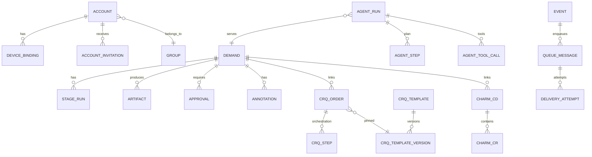

# 05 · 数据模型与接口

> 本文件描述界面背后的数据对象、状态、事件与接口约定。已有对象（Demand / StageRun / Task / Assignment / Artifact / Approval / Event / Hook）沿用现有 `docs/003-domain-and-protocol.md` 与 `docs/008-hooks.md`；本文只定义**本次重构新增或显式化**的部分。
>
> 原则：外部系统的实体沿用外部 ID；控制平面内部实体使用 ULID；所有写操作可幂等；工件与模板版本不可变。

## 1. 领域对象总览



## 2. 账号、小组与设备绑定

### 2.0 Account / Group

| 字段 | 说明 |
| --- | --- |
| `accountId` | 账号 |
| `email` / `name` | 企业邮箱 / 姓名 |
| `groupKey` | **唯一所属小组**；一个账号只属于一个小组 |
| `roles[]` | 业务 / 顾问 / 开发 / 测试 / Basis；由小组与授权决定 |
| `status` | `invited / active / disabled` |

**约束**

- `account.groupKey` 单值，不允许数组；调整小组必须由管理员执行并写审计事件。
- 小组决定需求默认可见范围、默认阶段模板、CRQ / ChaRM 模板与通知频道。
- 跨组协作使用任务转交 / 文档授权，不共享账号归属。
- 历史 Demand / Task 保留创建时的小组归属，不随人员调整而迁移。

### 2.1 AccountInvitation

| 字段 | 类型 | 说明 |
| --- | --- | --- |
| `id` | ULID | 邀请 ID |
| `email` | string | 企业邮箱 |
| `groupKey` | string | 关联小组 |
| `roleHints` | string[] | 业务 / IT / 顾问等 |
| `tokenHash` | string | 一次性链接 token 的 hash（不存明文） |
| `expiresAt` | datetime | 默认 10 分钟 |
| `usedAt` | datetime? | 使用后置位；只能用一次 |
| `invitedBy` | string | 邀请人 |
| `createdAt` | datetime | |
| `revokedAt` | datetime? | 管理员撤销 |

### 2.2 DeviceBinding

| 字段 | 类型 | 说明 |
| --- | --- | --- |
| `id` | ULID | 设备绑定 ID |
| `accountId` | string | 账号 |
| `fingerprintHash` | string | 浏览器指纹 hash（不存原始指纹） |
| `ipHash` / `ipPrefix` | string | 访问 IP（按合规要求存储） |
| `userAgent` | string | 设备 / 浏览器 |
| `deviceLabel` | string | 展示用（MacBook Pro · Chrome 156） |
| `credentialHash` | string | 设备凭证 hash；Cookie 只存随机值 |
| `status` | enum | `active / revoked / expired` |
| `expiresAt` | datetime | 默认 180 天 |
| `lastSeenAt` | datetime | |
| `revokedAt` | datetime? | 重新注册或管理员吊销 |
| `createdAt` | datetime | |

**规则**

- 同一账号可有多条历史绑定，但只有一条 `active`。
- 重新注册创建新绑定并吊销旧绑定（同一事务）。
- 指纹 / IP 不匹配时创建安全事件，不自动放行。

### 2.3 SecurityEvent

`kind`: `invitation_sent / link_used / bind_success / fingerprint_mismatch / re_binding / device_revoked / token_cleared`；记录 actor、IP、fingerprint hash、结果与时间。

## 3. 需求扩展

在现有 Demand 上增加界面需要的投影字段（存储仍以 SAP 为准，控制平面做快照）：

| 字段 | 说明 |
| --- | --- |
| `jiraKey` | JIRA Issue / Epic 号，可空 |
| `groupKey` | 所属小组 |
| `owners[]` | 负责人（多选，含角色） |
| `templateId` / `templateVersion` | 创建时固定 |
| `releaseWindow` | 期望 / 锁定上线窗口 |
| `backlogRank` | JIRA Backlog 排序（可空） |
| `releaseDocVersion` | 当前上线文档版本（可空） |

> 阶段、工件、门禁、任务继续使用原对象；界面只读投影，不新增第二套状态。

## 4. 文档批注与版本

### 4.1 Annotation

| 字段 | 类型 | 说明 |
| --- | --- | --- |
| `id` | ULID | |
| `demandId` / `artifactKind` / `artifactVersion` | | 绑定到具体版本 |
| `anchor` | object | 段落 / 行 / 文本片段 + 前后文 hash |
| `authorId` | string | |
| `body` | markdown | 批注内容 |
| `mentions[]` | string[] | @ 的人 |
| `status` | enum | `open / resolved` |
| `resolvedBy` / `resolvedAt` | | |
| `replies[]` | object[] | 简化线程 |
| `createdAt` | datetime | |

- 批注不修改工件内容；接受建议或交给 AI 时生成新版本。
- 解析锚点时若文本已变化，显示「原文已变更」而不是错位高亮。
- **AI 二次生成**：`POST /annotations/regenerate` 接收未解决批注 ID 列表；AI 以当前 Markdown 为输入生成 vN+1。生成结果不自动通过门禁，原版本保留。
- **文档格式**：当前只支持 Markdown（`contentType: text/markdown`），不做富文本 / Word 双向编辑。

### 4.2 版本规则（沿用 003）

- `artifactId` 不变，`version` 递增；旧版本永久保留。
- `authorType`: `ai / human / agent / import`。
- 本设计范围内，AI 生成与人工编辑的过程文档统一为 `text/markdown`；界面负责渲染、批注与版本对比。
- `stale` 标记在版本级；上游新版本会阻断下游门禁。
- 冲突合并生成新版本，不覆盖服务端版本。

## 5. CRQ

### 5.1 CRQTemplate / CRQTemplateVersion

| 字段 | 说明 |
| --- | --- |
| `templateId` | 模板 ID |
| `groupKey` | 小组 |
| `name` | 展示名 |
| `version` | 整数版本 |
| `status` | `draft / published / archived` |
| `fieldSchema` | 字段定义（名称、类型、来源、默认值、校验） |
| `orchestration` | 步骤顺序与接口映射 |
| `createdBy` / `publishedBy` / `publishedAt` | |
| `schemaHash` | 版本快照 hash |

**字段来源枚举**：`default / currentUser / charmApi / apiGenerated / manual / autoFromDemand`。

### 5.2 CRQOrder

| 字段 | 说明 |
| --- | --- |
| `id` | 内部 ULID；`crqNo` 为 SolMan 返回号 |
| `demandId` | 关联需求 |
| `groupKey` / `templateId` / `templateVersion` | 固定创建时版本 |
| `status` | `draft / running / pending_approval / created / failed / cancelled` |
| `fields` | 填写的字段快照 |
| `requestNo` | 请求号（接口生成） |
| `externalId` | SolMan CRQ 号 |
| `idempotencyKey` | 创建幂等键 |
| `createdBy` / `createdAt` | |

### 5.3 CRQStep

| 字段 | 说明 |
| --- | --- |
| `orderId` / `seq` / `key` | 步骤 |
| `status` | `pending / running / succeeded / failed / skipped` |
| `request` | 脱敏后的请求（method / path / body 摘要） |
| `response` | 状态码、耗时、外部 ID、错误摘要 |
| `attempt` / `startedAt` / `finishedAt` | |
| `deadLetter` | 是否进入死信 |

## 6. ChaRM

### 6.1 CharmChangeRequest

| 字段 | 说明 |
| --- | --- |
| `id` | `CR-xxxxx`（外部 ID） |
| `changeDocumentId` | 所属 CD |
| `system` / `client` | 目标系统 |
| `type` | Normal / Urgent / Config |
| `status` | `draft / pending_basis / approved / rejected / cancelled` |
| `transports[]` | 传输号 |
| `basisApprover` | 从 ChaRM 拉取 |
| `submittedAt` / `approvedAt` | |
| `polledAt` | 最近轮询时间 |

### 6.2 CharmChangeDocument

| 字段 | 说明 |
| --- | --- |
| `id` | `CD-xxxxx` |
| `demandId` / `crqId` | 关联 |
| `system` / `client` | |
| `status` | `draft / pending_basis / created / closed` |
| `owner` | 负责人 |
| `changeRequests[]` | CR 列表 |
| `syncLog` | 最近轮询摘要 |

### 6.3 轮询

- 默认 60s；手动「拉取状态」立即触发。
- 503 / 超时：指数退避，记录到同步日志；不改变本地状态。
- 审批通过：自动创建 CD（幂等），写事件与通知。

## 7. 队列、Hook 与投递

### 7.1 QueueMessage (outbox)

| 字段 | 说明 |
| --- | --- |
| `id` | ULID |
| `queue` | `teams-notify / smtp-approval / jira-sync / charm-poll / crq-orchestrator / ai-stage-runner / dead-letter` |
| `kind` | `hook / api / ai / dlq` |
| `eventId` / `eventType` | 源事件 |
| `payloadRef` / `payload` | 信封或请求摘要 |
| `idempotencyKey` | 重放不变 |
| `status` | `pending / inflight / sent / dead / cancelled` |
| `attempts` | 次数 |
| `nextAttemptAt` | 退避时间 |
| `lastError` | 脱敏错误 |
| `createdAt` / `updatedAt` | |

### 7.2 DeliveryAttempt

`messageId`, `attempt`, `statusCode`, `latencyMs`, `error`, `responseSummary`, `startedAt`。

### 7.3 重试与死信

| 类别 | 处理 |
| --- | --- |
| 网络 / 5xx / 429 | 指数退避：2s 起、×2、上限 5min、最多 5 次；429 尊重 Retry-After |
| 4xx / 信封非法 | 立即死信，不可自动重试 |
| 死信 | 人工重放，保持幂等键；记录操作人 |
| 回执 | 幂等落库；重复回执不重复写事件 |
| 对账 | 每日比对：外部有 / 内部无；内部已发 / 外部无；死信未处理 |

## 8. Agent 运行

### 8.1 AgentRun

| 字段 | 说明 |
| --- | --- |
| `id` | ULID |
| `demandId` / `stageRunId` / `stageKey` | 服务对象 |
| `status` | `queued / running / waiting_human / succeeded / failed / cancelled` |
| `model` / `promptVersion` | 可复现 |
| `inputArtifacts[]` | `{artifactId, version}` |
| `tokensIn` / `tokensOut` / `costUsd` | 记账 |
| `durationMs` | |
| `outputArtifactId` / `outputVersion` | 成功时 |
| `error` | `{code, message, retryable}` |
| `attempt` | 阶段内尝试次数 |
| `startedAt` / `finishedAt` | |

### 8.2 AgentStep / AgentToolCall

- Step：`retrieve / assemble_context / generate / validate / submit_gate`，含状态、耗时、摘要。
- ToolCall：`tool`, `argsSummary`, `status`, `latency`, `resultSummary`；不存完整 prompt / 敏感内容。

## 9. 扩展（Agent / Skill）与同步

### 9.1 ExtensionArtifact

| 字段 | 说明 |
| --- | --- |
| `kind` | `agent / skill` |
| `name` | `sap-developer` / `sap-dev` |
| `version` | 语义化版本或 hash |
| `source` | `server / repo-agents / repo-skills / user` |
| `channel` | `baseline / draft` |
| `contentRef` / `checksum` | |
| `enabled` | 团队默认 / 用户覆盖 |
| `updatedAt` | |

### 9.2 SyncState

`workspaceKey`, `kind`, `name`, `localVersion`, `remoteVersion`, `status`（`synced / modified / remote_ahead / conflict`）, `lastSyncedAt`。

## 10. 事件

### 10.1 Envelope（沿用 003 §4.4）

```json
{
  "seq": 12043,
  "id": "01J8ZQ9W3K5M2V7X4C6B8N0P1Q",
  "type": "crq.step.succeeded",
  "at": "2026-11-11T12:04:03Z",
  "subject": { "type": "crq_order", "id": "01J8...", "demandId": "R-2041" },
  "data": { "step": "create", "externalId": "CRQ-2026-0842" }
}
```

### 10.2 新增 / 界面依赖的事件

| type | subject | 用途 |
| --- | --- | --- |
| `account.invited` | account | 邀请发送 |
| `device.bound` / `device.revoked` | device | 设备绑定 / 吊销 |
| `annotation.created` / `annotation.resolved` | annotation | 批注 |
| `annotation.regenerated` | annotation | 批注交给 AI 生成新版本 |
| `group.updated` / `group.member_moved` | group | 小组与成员调整 |
| `doc.synced` / `doc.conflict` | artifact | 文档同步 |
| `crq.step.started/succeeded/failed` | crq_order | 编排步骤 |
| `crq.order.status_changed` | crq_order | 工单状态 |
| `charm.pending_basis` / `charm.approved` / `charm.cd_created` | charm_cd | ChaRM |
| `release.email_sent` / `release.confirmed` | demand | 上线审批 |
| `queue.dead_letter` / `queue.replayed` | queue_message | 队列 |
| `agent.run.started/step/tool/finished` | agent_run | Agent 运行 |
| `extension.synced` / `extension.conflict` | extension | 插件同步 |

> 事件只追加；界面通过 WS 增量推送 + `after=lastSeq` 补齐，不轮询整页。

## 11. REST 接口

### 11.1 账号与设备

| 方法 | 路径 | 说明 |
| --- | --- | --- |
| POST | `/auth/invitations` | 发邀请（管理员 / 自助注册） |
| GET | `/auth/links/{token}` | 校验一次性链接 |
| POST | `/auth/bind` | 绑定设备（指纹 / IP / 用户名） |
| POST | `/auth/rebind` | 重新注册（吊销旧设备） |
| DELETE | `/devices/{id}` | 解除绑定 |
| GET | `/devices` | 当前账号设备 |
| GET | `/security/events` | 安全事件 |
| GET | `/groups` | 小组列表（管理员） |
| POST | `/groups` | 新建小组 |
| PATCH | `/groups/{id}` | 修改分组规则 / 默认模板 |
| POST | `/groups/{id}/members` | 邀请 / 转移成员（审计；账号单小组） |

### 11.2 需求与文档

| 方法 | 路径 | 说明 |
| --- | --- | --- |
| GET | `/demands?status=&group=&owner=&q=` | 列表 / Backlog |
| POST | `/demands` | 创建（含负责人多选、附件、JIRA） |
| GET | `/demands/{id}` | 阶段、工件、门禁、关联单据 |
| POST | `/demands/{id}/artifacts` | 人工新版本 |
| GET | `/demands/{id}/annotations` | 批注 |
| POST | `/demands/{id}/annotations` | 新建批注 |
| POST | `/annotations/{id}/resolve` | 解决 |
| POST | `/annotations/regenerate` | 把未解决批注交给 AI 生成新 Markdown 版本 |
| POST | `/demands/{id}/release` | 提交上线审批 |
| POST | `/demands/{id}/release/confirm` | 业务确认（邮件深链） |

### 11.3 CRQ

| 方法 | 路径 | 说明 |
| --- | --- | --- |
| GET | `/crq/templates?group=` | 模板与版本 |
| POST | `/crq/templates` | 新建模板 |
| POST | `/crq/templates/{id}/versions` | 发布新版本 |
| GET | `/crq/orders?status=` | 工单列表 |
| POST | `/crq/orders` | 创建草稿 / 提交 |
| GET | `/crq/orders/{id}` | 步骤与日志 |
| POST | `/crq/orders/{id}/retry` | 从失败步骤重试 |

### 11.4 ChaRM

| 方法 | 路径 | 说明 |
| --- | --- | --- |
| GET | `/charm/change-documents` | CD 列表 |
| GET | `/charm/change-documents/{id}` | CD + CR + 日志 |
| POST | `/charm/change-requests` | 新建 CR（本地 SSO 时由扩展代理） |
| POST | `/charm/change-requests/{id}/refresh` | 拉取状态 |
| POST | `/charm/change-documents` | 审批通过后创建 CD |

### 11.5 运维与 Agent

| 方法 | 路径 | 说明 |
| --- | --- | --- |
| GET | `/ops/queues` | 队列指标 |
| GET | `/ops/queues/{name}/messages` | 消息 |
| POST | `/ops/messages/{id}/replay` | 重放（保持幂等键） |
| POST | `/ops/queues/{name}/pause` | 暂停 / 恢复 |
| GET | `/ops/hooks` | Webhook 投递 |
| GET | `/ops/api-calls` | 外部 API 调用 |
| GET | `/ops/agents/runs?status=` | Agent 运行列表 |
| GET | `/ops/agents/runs/{id}` | 步骤 / 工具 / 输出 / 成本 |
| POST | `/ops/agents/runs/{id}/retry` | 从检查点重试 |

### 11.6 扩展同步

| 方法 | 路径 | 说明 |
| --- | --- | --- |
| GET | `/extensions/agents?source=` | Agent 版本 |
| GET | `/extensions/skills?source=` | Skill 版本 |
| POST | `/extensions/sync` | 客户端上报本地 hash / 拉取更新 |
| POST | `/extensions/publish` | 发布本地草稿到团队（需确认） |

## 12. 队列与异步语义

- **至少一次**：所有 Hook / 邮件 / 外部调用均可能重复，消费方必须幂等。
- **幂等键**：`<demandId 或 subject.id>:<target>:<sha256(eventId)>`；重放不变。
- **顺序**：同一需求的事件按 seq 有序；外部调用不保证全局顺序，界面按 seq 展示。
- **可见性**：入队后立即可见 `pending`；执行中 `inflight`；结束后 `sent / dead`。
- **暂停**：暂停队列只停止消费，不丢消息。
- **保留**：成功消息保留 7 天；死信保留 30 天；审计事件只追加。

## 13. 数据边界与安全

| 数据 | 存储 | 边界 |
| --- | --- | --- |
| 浏览器指纹 | hash | 不存原始指纹；不用于跨站追踪 |
| 访问 IP | hash / 网段 | 仅安全审计 |
| 设备凭证 | HttpOnly Cookie + hash | 不进入 JS / 日志 |
| SAP SSO | 仅本地 | 不上传控制平面 |
| AI Key | 服务端 secret | 不下发客户端 |
| prompt / 输出 | 服务端 / SAP 批处理 | 不写客户端日志 |
| 代码 | 本地 | 控制平面只存摘要与链接 |

## 14. 与现有协议的关系

| 现有 | 本次变化 |
| --- | --- |
| `docs/003` 的 Demand / StageRun / Task / Artifact / Approval / Event | 保持；界面只读投影 + 新端点 |
| `docs/008` 的 Hook 信封 / 重试 / 死信 / 回执 | 保持；队列可视化读取 outbox |
| VSCode 执行器协议 | 保持；新增文档同步 / Agent 同步 / 本地 SSO 代理 |
| SAP ICF 入站 / 回写 | 保持；新增上线审批与业务确认深链 |

## 15. 非功能要求

| 项 | 目标 |
| --- | --- |
| 首屏 | Web ≤ 1.5s（内网）；VSCode 任务箱 ≤ 3s |
| 事件延迟 | WS 推送 ≤ 2s；断线补齐 ≤ 5s |
| 队列 p95 | Teams / 邮件 ≤ 2s；CRQ / ChaRM ≤ 8s |
| 可用性 | 控制平面 99.5%；关键写操作幂等 |
| 审计 | 所有状态变化可追溯到人 / 系统 / 时间 |
| 保留 | 事件 ≥ 7 天；死信 30 天；审计 ≥ 1 年（按合规） |
| 可访问性 | Web 关键路径 WCAG 2.1 AA |
